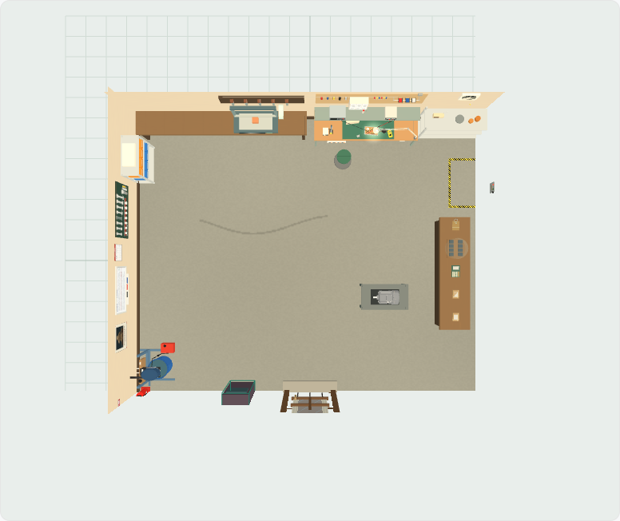
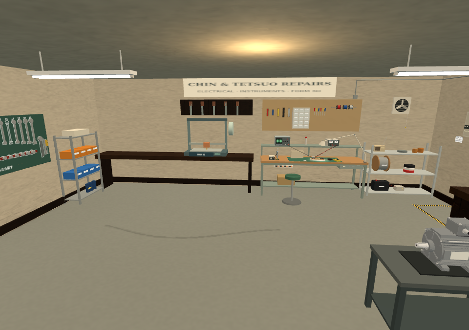

# Workshop authoring verification — 20 October 2026

Owner: start with a small real room (the workshop), then add an explicit floating/flying switch for comedy. The first
adapter implements intentional static floating; flight paths remain part of the unfinished animation timeline.

## Delivered behaviour

Studio opens the native workshop with eight stable assembly identities. The table, motor bench and arcade can move,
turn or be removed; eight extra static GLB props can be added. The original electrical corner, fabrication/printer,
Chin's wall, room shell and name board remain protected. Native models are never replaced by inert GLB snapshots.

UI proposals cross the existing `.room.json` boundary. Revision-checked MCP tools build and validate the actual room,
write the World data/module pair and retain rollback history. The runtime and Build scene consume that same data.
The first real revision moves the calculation table 15 cm east; normal support remains the default. The floating
cabinet and extra crate in the round-trip test were confined to a throwaway publication and were rolled back there.

## Evidence

- 53 focused unit/geometry/contract/protocol tests; 3 runtime-package tests; 5 existing surface tests: all pass.
- Generic room recovery, replacement, undo/redo, stale tabs and file exchange pass on desktop and phone.
- Native desktop/phone tests cover explicit floating, floor reset, protected fields, file exchange, new GLB props,
  full-room GLB export, actual runtime and scene builders, dry runs, publication, stale revision/source refusals,
  blocked-doorway refusal and monotonic rollback.
- The compiled workshop builder is separately loaded from the shipped chunk: checked table position, door/staff
  clearance and machine/arcade prompts pass at 960 and 390 pixels. These captures isolate the real compiled room;
  they are not screenshots of the whole game. Its actual World gameplay functions remain attached.
- New shared builders initially produced 40 compiled entries against the existing limit of 36. Consolidating the
  workshop/content helpers and their dependencies brings the graph to 32 without changing the limit or lazy diagnostics.
- During self-review, preview disposal was corrected to collect removable geometry before disposing live helper groups,
  while preserving shared cached motor resources. Older location camera framing was retained.

Run `workshop-room.test.mjs`, `workshop-room.browser.mjs`, `workshop-world.browser.mjs` and the existing runtime-package,
Tetsuo/Chin/shop and no-z-fighting suites. See [WORKSHOP-ROUNDTRIP.md](../../WORKSHOP-ROUNDTRIP.md) for the exact workflow.

Full-island startup on SwiftShader did not complete its first preview frame within the 60-second diagnostic window;
the unchanged-main baseline stops at the same Drawing the island step with all 24 assets loaded and no page errors. See startup-comparison.json. Physical Safari and the complete repository suite were not tested.
No whole-island physics or all-camera z-fighting clearance is claimed.

