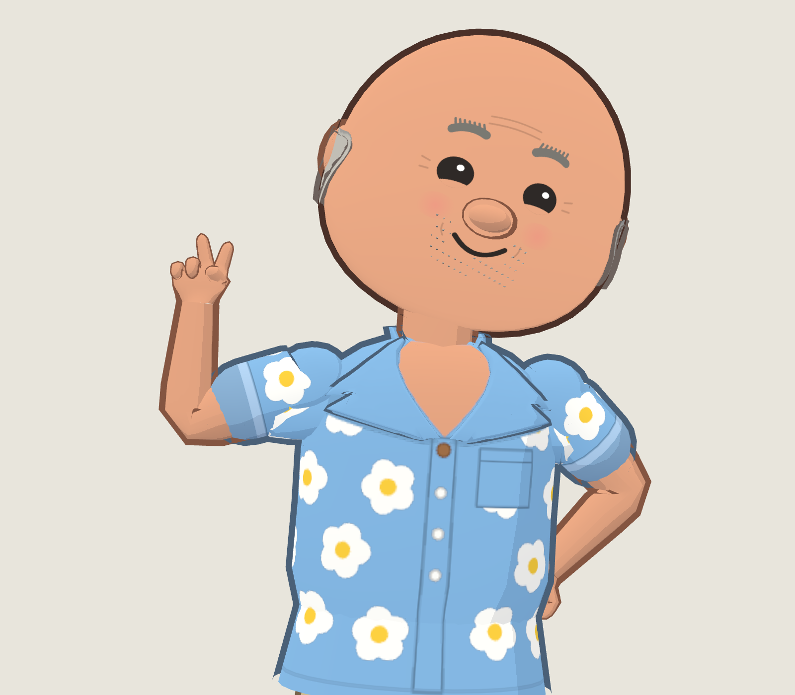
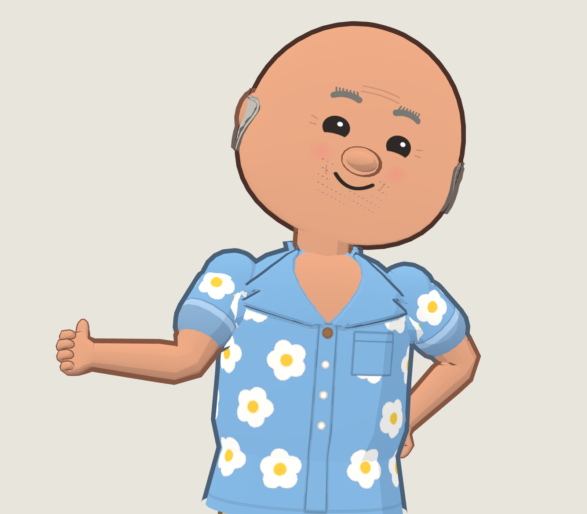
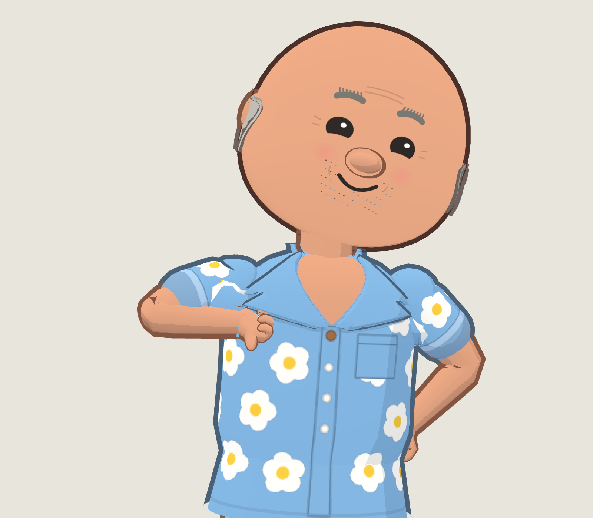

# Connected hand prototype — 21 October 2026

Original prototype for visual review on the real Johansson avatar. Not a finished asset, not deployed, and not a replacement accepted into Studio or World.

This experiment replaces the former independent palm/pad/digit assembly with one connected indexed hand surface: 403 used vertices and 784 triangles per hand, with a single 20-edge opening at the arm. It introduces explicit anatomical handedness, a thumb web, shared finger roots, varied finger lengths and thumb opposition. The experimental optional arm has an open wrist endpoint and distal skin weights that blend towards the hand. Legacy avatar defaults are unchanged by the patch.

The screenshots render Johansson's existing recipe/materials and a settled body animation through the existing Three.js renderer. The arm poses are explicitly authored in `render.mjs`: peace lifts the forearm without an extra wrist twist; thumbs up/down use different complete arm configurations and a thumb-extended hand shape. These are pose studies, not proof that existing Studio gesture buttons or a moving performance are integrated. Both thumbs point in their named direction in the shown front view.

Known remaining defects: folded-thumb shape in peace, wrist shading/outline continuity, elbow volume at deep bends, and curled-finger contact need further modelling. The left/right landmark contract is now tested, but complete palm/back/side visual acceptance of every gesture remains outstanding. The stills do not establish animation quality or hardware performance.

Verification performed on the applied prototype: 40 focused tests passed, including three new structural/anatomical tests and the existing avatar, hand-control, pose, motion, scene and performance tests. The new checks establish connectedness, a wrist-only boundary, no degenerate triangles, consistent edge winding, finite normals/weights and signed handedness through rotations. No runtime package build, full UI browser suite, physical-device checks or continuous animation/contact review is claimed for this experiment.

The replacement is stored as `prototype.patch`, rather than silently changing the production source or regenerating the live runtime. Apply it only in an isolated checkout of `codex/shared-bare-hand-rig` at `5f55b0545ef9180ecdd59c658620728b1cbe1335`:

```sh
git apply avatar-creator/experiments/connected-hands/prototype.patch
node --test johansson-town/tests/hand-surface.test.mjs johansson-town/tests/hands.test.mjs
POSE_CHROME=/path/to/chromium node avatar-creator/experiments/connected-hands/render.mjs
HAND_GESTURE=thumbsUp POSE_CHROME=/path/to/chromium node avatar-creator/experiments/connected-hands/render.mjs
HAND_GESTURE=thumbsDown POSE_CHROME=/path/to/chromium node avatar-creator/experiments/connected-hands/render.mjs
```

`HAND_SIDE=L` selects the character's left hand. Playwright normally resolves from the town package; `PLAYWRIGHT_PACKAGE` can point to a package.json in another installed dependency root. The renderer uses a local, read-only server and imports the actual avatar modules. No image generation or paintover is used.




