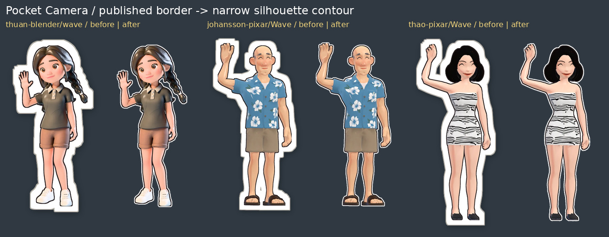

# Sticker contour evidence — 31 October 2026

[PR #414](https://github.com/nj22az/nj22az.github.io/pull/414), same integration branch; **not published**.
All comparisons use the actual published assets beside the actual recut assets, at identical canvas/figure scale.



All **116 before/after pairs** were inspected:
[Blender Thuan](thuan-blender-comparison.jpg), [Johansson](johansson-pixar-comparison.jpg),
[Thao](thao-pixar-comparison.jpg), [World Thuan](thuan-pixar-comparison.jpg),
[Cartoon Thuan](thuan-comparison.jpg), [pairs](thuan-nils-comparison.jpg).
The contour follows the silhouette; white shoes, clothing, hands and the pair figures are retained.

[Editor phone screenshot](phone-sticker-contour.png) · [saved-photo phone screenshot](phone-sticker-saved.png).
Actual **390 × 664 Chromium/SwiftShader emulation**, not physical iPhone Safari. The sticker was enlarged for inspection.

- [Browser log](browser.log): **4/4**, all 232 assets decode, keys/dimensions match, pale shoes remain opaque, new
  cut-outs/photo stickers have a fine rim, preview/export sticker pixels match exactly, saved ID persists, no page error.
- [Camera regression](camera.log): **56/56**, including custom stickers, gestures/handles, capture, save/re-edit and Memory.
- [Contour unit log](contour-unit.log): white clothing, real pale shoes, concave gap and unchanged dimensions.
- [Camera units](unit.log): all existing unit/module checks pass.
- [Asset hashes](assets.json) and [recut metrics](recut.json): all 116 full assets and 116 thumbnails; unchanged sizes.

Reproduce with Pillow, NumPy and SciPy (generation only):

```sh
python3 tools/camera-sticker-contours.test.py
python3 tools/camera_sticker_contours.py --baseline-ref 87f47e8f
python3 tools/camera-sticker-contour-proof.py
CAMERA_SHOTS=/tmp/contour-shots node camera/tests/sticker-contour.browser.mjs
```

Source: existing website sticker art, originally from `nj22az/jojo art/stickers/*/plain at 7803e69`; no character repainting,
new model generation or studio modification. The future studio-to-web builder uses the same recut helper.
See [handover](../../HANDOVER-STICKER-CONTOURS-2026-10-31.md) for exact prior commits, cache keys, checks, early-generation
corrections and the old custom-sticker limitation. The original integration evidence is [here](../2026-10-30-integration/README.md).
