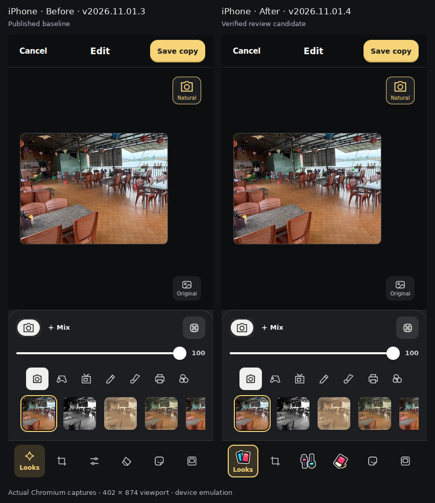
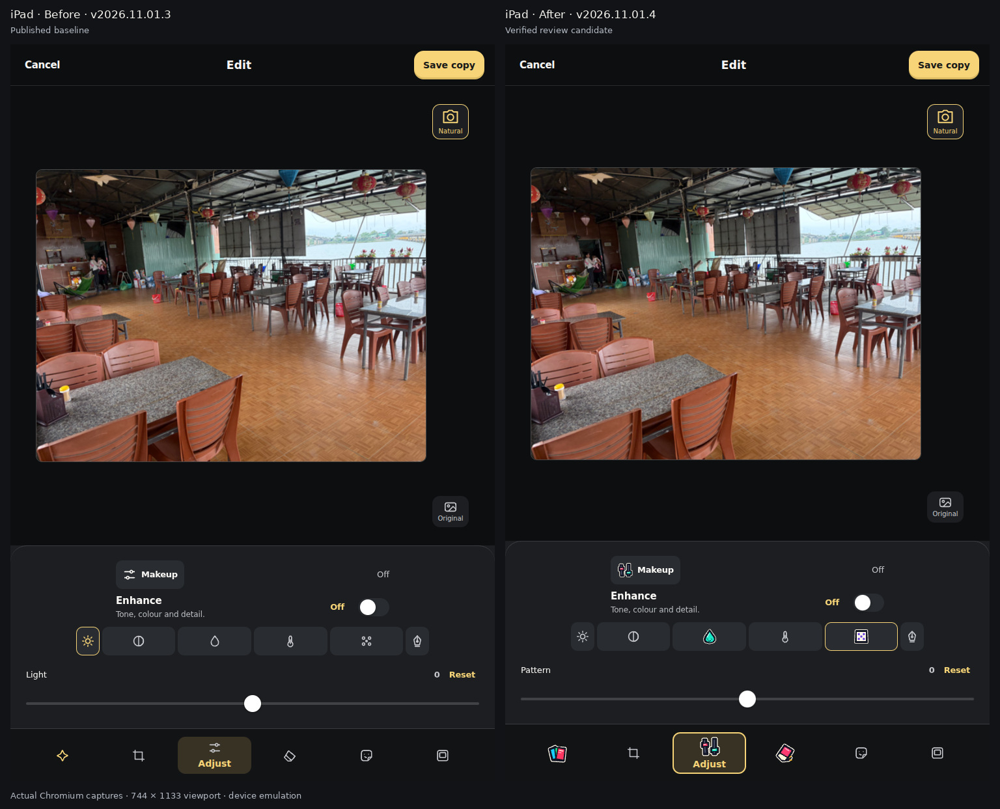

# Pocket Camera action icons: reviewed browser evidence

[PR #424](https://github.com/nj22az/nj22az.github.io/pull/424), verified runtime source
`e67f63bb8d90dc062a6cb7ada0f8094a2864d9f2` (tree `909d709eb17ca81234d98cc795d216e51a6e6988`).
The final evidence/handover commit changes documentation and screenshots only. Candidate v2026.11.01.4 is not published.

## Actual before and after

The baseline is published main `ab35ac3e9cc7d6dadac8c05178a04da42cef50da` (v2026.11.01.3).
The test overlays its exact index, app, base/UI CSS and renderer; both versions use the same sample photograph.
These comparisons add only labels/margins to actual screenshots. JPEG copies are supplied here for review;
all 44 original PNG captures are in the Camera UI artifact and the owner's delivered screenshot archive.

The iPad Adjust view shows Light selected before and Pattern selected after the interaction checks; both values are zero.
Phone/tablet landscape, settings, disabled Undo, viewer and the other panels were also captured and inspected.
Photographic Look symbols and thumbnails remain separate from the new colourful actions.

## Verification

[Camera run 41315825688](https://github.com/nj22az/nj22az.github.io/actions/runs/41315825688): all six jobs passed,
**379 reported browser checks**, including **82 existing UI + 32 action-icon** checks. All **16 unit suites** pass.
[MCP run 41315825547](https://github.com/nj22az/nj22az.github.io/actions/runs/41315825547): **16 policy + 20 real acceptance**.
[World guard](https://github.com/nj22az/nj22az.github.io/actions/runs/41315825603): **580/580** unit/source checks passed.
Separate long World browser checks may still run; they are not claimed as Camera acceptance here.

Runtime hashes, exact counts, viewport sizes, artifact SHA256 and limits are in [verification.json](verification.json).
UI artifact **13086883459** ZIP SHA256 `9ffebd5c476786b209cd9cb24dc45cee402f5acf2e6be4c3c813d172974436fd`;
ZIP digest, CRC and extraction paths were verified before inspection. Core artifact **13086944049** SHA256
`c7c3c1655b073f6160211a8eabd8ff7b00c930c713cc418cd19a553719201e9f`.

The keyline has 18.37:1 contrast against the normal surface and 12.10:1 against the selected surface.
A visible outline and active label express selection independently of icon colour. Disabled Undo remains disabled,
with desaturated/dimmed artwork; every tested action target remains at least 44 × 44 CSS pixels.

Limits: physical iPhone/iPad Safari, actual camera/native Share and installed Home Screen appearance are untested.
Two Chromium context-restoration branches could not be exercised on this runner. Linux retains the two documented
World failures (ferry spawn and post-office lot); no related code or assertion was altered. Earlier missing photos
are not diagnosed by this icon change. Main publication remains the owner's decision.
