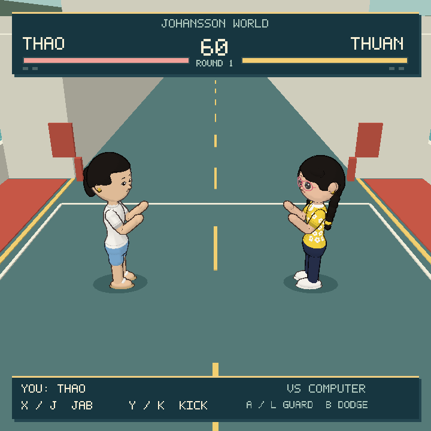

# Ferry Deck Fighters

A separate native 3D fighting-game prototype with **Thao and Thuan**, set on the **Minato Maru car deck** from Johansson World. Primary target: **Anbernic RG CubeXX (Linux/H700)**. Linux desktop is the development target. No browser or JavaScript runtime is required.

This is the first playable foundation, not a finished game or a certified PortMaster package. The 60 fps hardware target is **not yet measured on a CubeXX**.



## Implemented

- Two selectable fighters: Thao (white tee, blue shorts, high ponytail) and Thuan (yellow flower blouse, navy trousers, rose glasses, braids).
- Fully 3D arena and movement; opponents automatically face one another.
- Jab, kick, frontal guard, dodge with a limited invulnerable window, recovery, hit stun and hit stop.
- Computer opponent, passive training opponent, 60-second rounds and first to two wins.
- Square-screen HUD, title, pause, results and fighter switching.
- Keyboard and SDL2 standard controller input, controller reconnection and pause on focus loss.
- Small synthesised hit/block sounds; audio is optional.
- Fixed 60 Hz combat simulation independent of rendering cadence.
- GLES 2.0 compatible vertex-colour renderer. Static arena geometry is uploaded once; fighters use streaming batches with skinning, alpha accessories and source-style ink outlines; the UI uses its own batch. The original face and garment textures are retained in per-character atlases. No network requests or runtime asset downloads.

## Build and run on Linux desktop

Requires a C99 compiler, make and the SDL2 runtime (`libSDL2-2.0.so.0`) and zlib (`libz.so.1`) for the compressed Studio assets. SDL2 development headers are not required: the small platform adapter loads a narrow documented SDL2 ABI dynamically.

```sh
make
make test
./build/ferry-deck-fighters
```

On Debian/Ubuntu, the runtime package is normally `libsdl2-2.0-0`. Use `--gles` on a system with OpenGL ES 2.0 and EGL drivers. `--fullscreen` preserves a square viewport.

| Action | Keyboard | SDL controller position |
|---|---|---|
| Move / sidestep | WASD / arrows | Left stick / D-pad |
| Jab | J | X / west |
| Kick | K | Y / north |
| Guard | Hold L | Hold A / south |
| Dodge | Space + direction | B / east + direction |
| Start / pause / continue | Enter | Start |
| Pause / title / quit title | Escape | Back / Select |
| Switch player (title or pause) | Tab | L1 |
| Training (title or pause) | T | R1 |

The controller labels shown are SDL's standard layout; CubeXX physical button mapping still needs verification. Either fighter is playable, with the other controlled by the computer. Two human players and multiplayer are not implemented.

## ARM64 build

Using Zig 0.13.0 as a cross compiler:

```sh
make CC='zig cc -target aarch64-linux-gnu.2.17 -mcpu=cortex_a53' \
  CFLAGS='-O2 -std=c99 -Wall -Wextra -Wpedantic' \
  -B
```

This compiles against glibc 2.17 and the Cortex-A53 instruction baseline. The resulting executable needs an ARM64 Linux userspace with that glibc baseline, SDL2, and functioning EGL/GLES drivers. It has not been executed on the handheld. Stock and custom firmware differ: see [hardware acceptance](docs/HARDWARE.md).

## Inspect the current prototype

[Four-view screenshot sheet](screenshots/Ferry_Deck_Fighters_Inspection.png), [title](screenshots/title.png), [jab](screenshots/jab.png), [kick](screenshots/kick.png), [guard](screenshots/guard.png), [result](screenshots/victory.png).

These are captures of the actual native renderer at 720 x 720, using deterministic staged game states for comparison. They are not concept art. `--demo` runs AI versus AI using the real combat simulation. Regenerate screenshots on a Linux Mesa development machine with:

```sh
make
python3 -m pip install Pillow
python3 tools/capture_screenshots.py
```

Pillow is used only by the screenshot tool, not by the game.

## Source relationship and limits

The fighter assets are exported by **Johansson Studio**, using the same `recipeFor` and `buildAvatar` code as World. The reconstructed C characters have been removed. Exact source mesh positions, normals, UVs, skin weights, 28-bone skeletons, painted faces, garment textures and separate glasses are preserved in the JWF3 files. Lighting, camera and combat animation are native, so screenshots are not expected to be pixel-identical to Studio portraits.

In Studio, use **Files → Export native fighter** to download the selected character as `.jwf`. The exporter is `avatar-creator/native-export.js`. The game can load uncompressed `.jwf` files or the included losslessly compressed `.jwf.gz` assets. `assets/characters/manifest.json` records recipes, source commit and SHA-256 hashes of the uncompressed exports.

The committed exports were generated in a real browser using Studio's exporter. `tools/verify-studio.cjs` regenerates the exports and Studio reference portraits, then verifies the actual Files download button. `tools/export-studio.mjs` is an optional Node/canvas build route. Run `make test` for both combat and model checks. [Studio / native comparison](screenshots/Ferry_Deck_Fighters_Studio_Comparison.png).
The ship dimensions and arrangement follow `johansson-town/src/world/ferry-model.js`: 34.5 x 8.4 m, side casings ending at station 20 m, bow houses beginning at station 30 m, a 4.6 m bow ramp and red/white vehicle barrier at station 29.3 m. The combat origin is station 24 m. The native ferry scene is a simplified recreation, with an added sparring rectangle, not an engineering model or a transfer of the entire ferry.

Open work: animation polish, hand/hit-volume alignment, target controller mapping, CubeXX firmware packaging, device profiling, audio-device verification, throws/combos, accessibility settings and additional arenas. Studio gains the reusable native export action; World character definitions remain shared.
