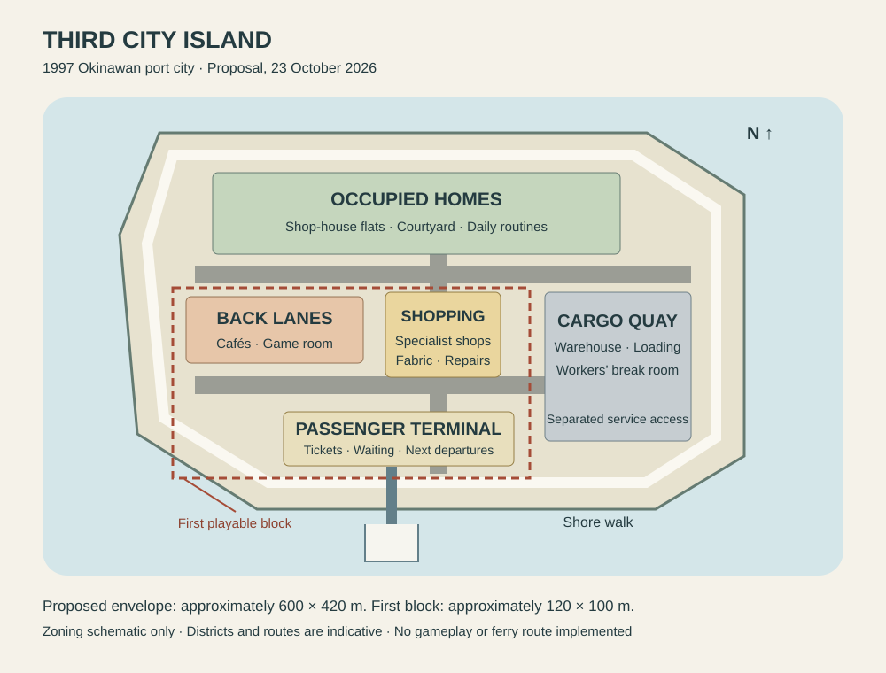

# Third city island — design and implementation proposal

23 October 2026. Owner request: add Slop New York as a reference and plan a third city island based on it and
New Yokosuka. **Status: planning only; no third island is playable or connected to a ferry in this change.**
Island name, final position, businesses, cast additions and sailing times below remain proposals.

**Owner priority, 23 October 2026:** making Minato island impeccable and immersive is priority 1. The third city island is low priority and deferred. Retain this research and proposal for later; do not begin further city design, prototyping or implementation unless the owner explicitly reprioritises it.

## Purpose and identity

Create a separate, denser Japanese port city within Johansson World's 1997 Okinawan setting. Minato stays the
compact home port; Kitano-jima stays the tropical island. The third destination provides a worthwhile day out:
specialist shopping, cargo business, cafés, evening encounters and new places to photograph or use in stories.
It is not a recreation of New York or Yokosuka. Use the neutral working id `city-island` until a name is chosen.

Slop New York supplies technical lessons; New Yokosuka supplies street and room lessons. Read the
[source assessment](../docs/research/slop-newyork.md) and [existing measured study](../docs/research/new-yokosuka-lessons.md).
Preserve Johansson's playful cartoon characters, materials and Look choices. Tall blocks should frame people
and stories rather than dwarf them behind an anonymous skyline.

## Proposed plan and dimensions

The drawing is a zoning schematic, not surveyed CAD. All sizes below are proposed design targets,
not newly measured New Yokosuka dimensions or claims of legal compliance.

| Element | Initial target | Reason |
| --- | --- | --- |
| Whole island | Approximately 600 × 420 m including shore and working waterfront | City atmosphere without a kilometre-scale walking burden; boundary can shrink after the first-block review |
| First playable area | Approximately 120 × 100 m, terminal and two short street blocks | Complete the arrival, shopping and return journey before building the rest |
| Main shopping spine | Approximately 180 m; 5–8 m frontage modules | A legible street of individual businesses, using measured doorway rhythm as a reference |
| Main carriageway | 6 m, two lanes; 2 m clear footway each side | Small buses and delivery traffic, separated from browsing pedestrians |
| Back lanes | 3–4 m, shared access with controlled deliveries | Human scale and believable service entrances |
| Most buildings | Two to four storeys, with a few five- or six-storey landmarks | Denser than Minato while retaining visible shop signs and manageable sightlines |
| Small shop | Roughly 5–8 m frontage and 6–10 m depth; 2.6–2.9 m ceiling | Useful interiors whose walls and windows match the exterior envelope |
| Cargo district | Initially one approximately 70 × 80 m working yard | A visible delivery chain, not acres of unused warehouses |

Footways remain clear of signboards and bins; crossings have dropped kerbs; shop queues cannot obstruct a door.
Use the existing [ground standard](../docs/GROUND-STANDARD.md) and generators. New island district membership
must be added explicitly to their data and audits; copying a Minato-only validator is not sufficient.

## Districts and reasons to visit

| District | Contents proposed | Play and story purpose |
| --- | --- | --- |
| South passenger quay | Ferry berth, ticket desk, waiting room, toilets, public telephone, bus stop | A readable arrival; missed-boat decisions; a meeting place with a reliable return route |
| Central shopping street | Clothing and fabric shop, electrical/appliance repair, stationery and record shop, small food shops | Thuan can source fabric or shop fittings; Nils can collect an ordered part. Existing Sakura supply arrangements remain intact. |
| West back lanes | Small cafés, noodle counter and an original game room | Short conversations, dining, rain shelter and evening stories; original games and branding |
| North residential quarter | Occupied shop-house upper floors and a small courtyard block | Residents go home after closing. Every added household has an assigned interior, bed, entrance and routine. |
| East cargo quay | Warehouse, loading bay, repair supplier and workers' break room | Goods are collected, loaded and delivered through reachable spaces; staff work and take breaks. |
| Shore walk and small square | Continuous pedestrian circuit except for clearly separated cargo access | A relaxing loop, photographs and scenic comic backgrounds; clear harbour landmarks guide the return. |

Do not create all these premises at once. Phase 1 contains the terminal, one staffed specialist shop and one café,
with the workers' actual accommodation included. Remaining districts stay on the plan until occupants and gameplay
are specified. No decorative doors imply enterable rooms; no surplus empty homes are built for later.

## Transport and continuity

Keep Minato Maru's approved Minato–Kitano-jima timetable untouched during prototyping. The present source uses
route-specific berth, fare and save state, including legacy `town`/`airport` journey labels; adding a third stop is
not just adding another coordinate.

For the first city connection, plan a separate scheduled passenger service from Minato, with a modest vessel and
identified crew. Its timetable must be checked against visiting residents' shifts before it is enabled. Do not borrow
an on-duty Minato Maru crew member or silently replace the existing service. Decide vessel and crew assignments
in the transport phase; none are made canonical here. Price and sailing time remain unset until that audit.

The new service keeps its published time even when the player is ashore. Show next departures and last returns at
both terminals. Include safe gangway handling, missed departures, an overnight option, weather cancellation and
return recovery. A city visit must not strand a save or require a reload. Begin with walking and a small delivery loop;
player driving, bicycles and a city bus are later scope, not prerequisites. Use left-side traffic and marked crossings.

## Residents, shops and stories

Do not relocate the existing cast or change their ownership/ship roles as part of this plan. Before adding any city
resident, reconcile the latest roster and owner decisions. A proposed worker needs a name and purpose, workplace,
home or valid commute, opening shift, break and closing route. A shop needs stock, suppliers, prices and handover
anchors so goods do not appear by magic. No unattended 24-hour shops without staffing.

The first story loop is deliberately small: arrive with a parts order, collect it at the electrical shop, wait at the café
while a delivery is prepared, collect the parcel, and catch a scheduled return. Each place should also work without
the player. Storyteller entries and Studio backdrops refer to the same built room, props, seats and residents.
Draft hooks include a parcel with the wrong label, an umbrella left at the café and a last-boat meeting.
Current fighting stays withdrawn; no combat, borrowed arcade ROMs or imported Shenmue performances.

## Engine integration and performance

Retain Three.js r170/WebGL and the shared avatar, lighting and Look systems for the first implementation.
Upstream WebGPU/TSL is a separate research direction, not a prerequisite or a second renderer embedded in World.
Use current `src/render/town-sections.js`, `section-instances.js` and `static-props.js` before adding another batching
system. Slop New York's chunking and shadow proxies are candidates only after comparison with those systems.

Extend the on-demand approach in `src/world/kitano-on-demand.js`: a cheap distant silhouette first; bounded city
chunks prepared during travel; collision, anchors and required interiors ready before disembarkation. The current
Kitano loader builds and retains its content; it is a precedent, not proof of full region unloading. City loading must
also define cancellation, GPU-resource disposal, shared-resource ownership and safe repeated visits. Never unload
shared avatar/material assets while another region uses them.

Keep the world clock, resident schedules and trade state running outside the visible region. Materialise a returning
resident at a valid point on their current route, not through furniture. Inside a room, render that room and bounded
window views rather than the whole city, while outside simulation continues.

Performance targets: 60 fps desktop and 30 fps tablet on named test hardware, with the same visual standard and
allowed differences in resolution/shadow detail. Establish the current-game baseline first. Record median and p95
frame time, draw calls, submitted triangles, loaded texture/geometry memory and loading stalls on a fixed route.
Repeat three island return trips: retained resources must settle rather than grow on every visit. Record actual
measurements and hardware; cloud screenshots cannot establish iPad or Steam Deck performance.

## Delivery sequence and acceptance

| Phase | Deliverable | Completion evidence |
| --- | --- | --- |
| 0 — Plan (this PR) | Pinned technical reference, district concept and staged brief | Links and source claims checked; no runtime changes |
| 1 — Measured block | CAD/site plan for terminal, specialist shop, café and staff homes, then an isolated playable prototype | Exterior/interior envelopes agree; clear entrances, service routes and stairs; overhead and pedestrian screenshots at desktop and 390 × 844 |
| 2 — Region lifecycle | City loads on demand using the existing renderer | Arrival waits for valid ground; cancelled load and three return trips succeed; measured resource retention; no added full-city startup cost |
| 3 — Travel and saves | Separate timetable, vessel/crew plan and return connection | Old saves load; new destination round-trips; mid-crossing recovery; missed boat, last boat and weather cases; existing ferry schedules unchanged |
| 4 — Living block | Assigned workers, trade, food service and first story loop | Walk door-to-counter-to-home; deliveries and closing physically work; occupied beds; story props and captured backdrops match rooms |
| 5 — City expansion | Complete one additional district per review | Each district has a purpose, staffing, homes, validated routes and measured performance before the next is built |

Future runtime PRs run the World guard, focused ground/collision/navigation/schedule/save tests,
`npm run build:runtime` and `node --test tests/runtime-package.test.mjs`. Inspect real-game day/night/rain views,
moving traffic at crossings, contact and z-fighting. Exercise browser and Linux paths; record physical-device limits.
Present visual evidence before merging visual changes, following the repository's working rules.

**Deferred next step, only after explicit reprioritisation:** produce the phase-1 measured site plan and room plans before any city geometry reaches the main world. Current work takes priority on Minato's quality and immersion.
