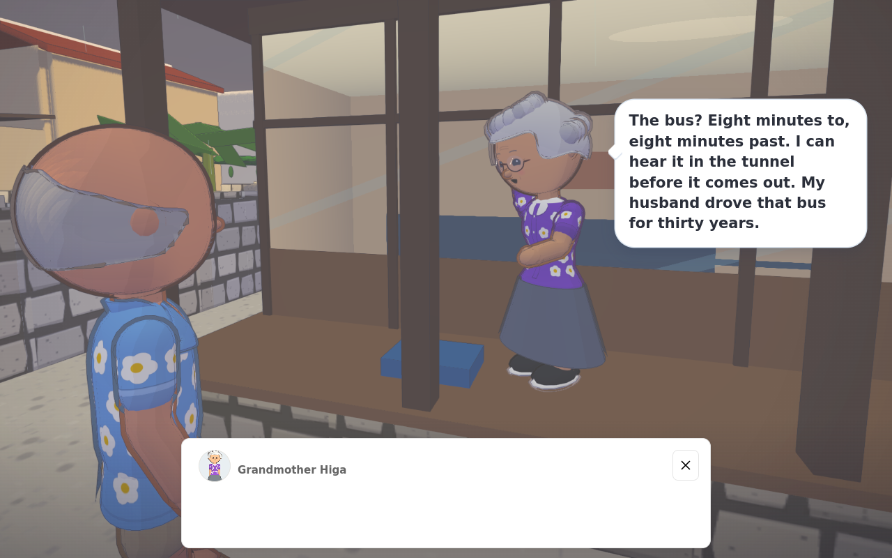
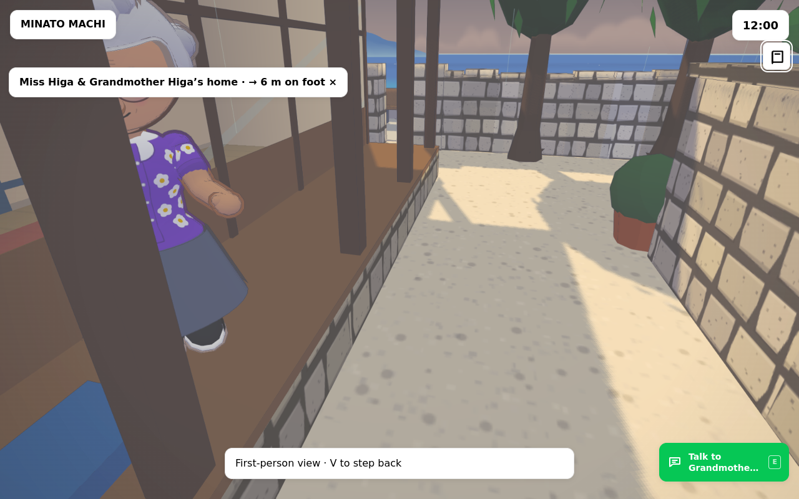

# Ferry departure, conversations and the Higa veranda

Implementation record · 17 October 2026

This follows the [Minato consolidation](MINATO-CONSOLIDATION.md), published in PR #183. The park, Onsen, shop and household changes remain in place. This follow-up addresses the requested ferry operating sequence, side-wrapping speech and flashing veranda edge.

## Ferry behaviour

The Minato Maru now has one operating controller for requested passenger trips and unattended vehicle trips. Requesting a crossing starts preparation. It cannot set the ship's position along the route or skip the crew, machinery, vehicle, access or line checks.

The ship stays at her berth while the crew work. A task has three distinct states: assigned, acknowledged at its physical station, and completed after the work gesture. An unavailable route or an unaccepted machine command remains an explicit hold. The eight posts in the existing manning plan are represented on board.

### Chain of command

| Post | Person or role | Responsibility during departure |
| --- | --- | --- |
| Master | The former Harbour Line bus driver | Reviews the route and traffic, receives departmental reports, accepts machinery control and gives the final departure and manoeuvring orders. |
| Chief officer | Chief officer | Supervises deck readiness, the ramp, closures, lookout and mooring reports. |
| Chief engineer | Mr Nakandakari | Leads machinery preparation, electrical supply, main engines, steering checks and the report to the bridge. |
| Oiler | Mr Higa Jr | Carries out machinery rounds, auxiliary and lubrication work under the chief engineer. His home remains Flat 1, Kitahama Heights. |
| Bosun | Ms Uezu, with Kōji covering her relief week | Leads vehicle securing and the after mooring station. |
| Able seafarer / deck hand | Deck hand | Supervises passenger access and works the forward mooring station. |
| Purser | Purser | Checks the passenger count and exits, confirms drivers have reached the passenger area and attends passengers. |
| Cook-steward | Cook-steward | Secures galley equipment and loose stores, then keeps the galley watch. |

The shore line handler is outside the ship's eight-person complement. Mr Fujita works the Minato pier; a Kitano line hand works the opposite landing. The Minato controller uses Fujita's existing body and returns him to his ordinary activity after the job.

### Startup and departure sequence

1. **Prepare the ship.** The master issues stations. The chief engineer checks fuel, cooling, starting air and the engine room. The deck and passenger teams check their areas in parallel.
2. **Establish ship's power.** Start the first generator, transfer from shore supply and bring the second generator onto the board for harbour manoeuvring. Start the required ventilation, steering power units and auxiliaries.
3. **Prepare the main engines.** Prime lubricating oil where the engines are stopped; start each main at idle, check the indicated oil pressure and cooling, and complete the steering/control handover. Running warm machinery is checked without pretending to start it again.
4. **Secure vehicles and clear the drivers.** Engines off, parking brake applied, appropriate transmission setting checked, wheel chocks and wheel straps fitted. The actual driver leaves the vehicle and walks to the passenger lobby.
5. **Close access.** Check the ramp and gangway are clear. Recover the passenger gangway and close its access.
6. **Raise the ramp.** Run the hydraulic pump through the model's 60-second raising time; verify the raised position and both locking pins. The forward and after teams reach their mooring stations.
7. **Recover the lines individually.** The shore handler reaches the relevant bitt, lifts and returns the line eye. The shipboard rating receives it, heaves the line in and coils it aboard. The remaining lines retain their own visible states.
8. **Receive reports and depart.** Both mains, electrical power, steering and bridge control must be ready; every vehicle must be secured and every driver in the passenger area; the ramp must be locked, the gangway stowed and all lines aboard. The master then orders propulsion for the first manoeuvre.
9. **Keep the passage watch.** Propulsion orders follow the actual astern, swing, harbour, sea and approach legs. The ship accelerates and turns gradually. Johansson can walk and look around aboard.
10. **Arrive and make fast.** Approach slowly, stop propulsion at the berth, put out and make fast the lines, and only then lower the ramp and restore access. Vehicle restraints are removed and the drivers return before vehicles unload.

The durations are game tuning for the existing miniature harbour. They are not manufacturer instructions. A cold start includes extra machinery work; a warm turnround still needs readiness reports and the complete ramp and mooring sequence. Walking time to stations is real and can extend preparation.

The two cleared sailing tracks are approximately 375 m long. Motion takes 317.58 seconds outbound and 399.11 seconds returning—roughly 5.3 and 6.7 minutes—with a 3 m/s open-water maximum and substantially slower harbour legs. Preparation, walking to stations, ramp handling and making fast add to those motion times. Incomplete work or an obstruction can extend the operation. The existing personal **Quick crossing** remains available at the landings.

The 22 town-minute journey accounting remains for each accepted passenger or requested pickup leg; unaccompanied cargo voyages let the town clock advance naturally. The existing road traffic service currently carries one owned vehicle per voyage, although the vessel’s design accommodates six cars. Reloading during a voyage returns to the last saved safe shore; exact operating and machinery progress is not persisted.

### Read the operation while watching it

Open **Town tools → Ferry departure & crew**. A compact live panel shows the current stage, incomplete conditions, vehicle clearance, ramp/gangway state and recovered or made-fast lines. Its disclosures contain the startup sequence, named crew duties and recent reports. Reading it does not issue an order or pause the ship.

### Physical work areas

The forward bow-house roofs previously lacked walking floors, and the visible vertical ladders were treated as solid walking obstacles. The roofs now have floors exactly on the green deck surface, with matching rails, windlass, bitts and fairlead collisions. Explicit climbing connections let the AB reach the forward station without moving through the bow house.

The engine-room, stairs, lobby, bridge, ramp and mooring routes use the same ship floors and solids as ordinary movement. The galley provision locker is shortened at its doorway to leave space for the cook to enter. The ramp control pedestal remains a physical object, with the operator standing beside it. Secured cars also obstruct bodies and cameras on the vehicle deck, without obstructing the deck above them.

## Conversation visibility

Conversation and ambient balloons wrap beside their speaker. Placement protects both characters' projected faces and bodies. A complete line reserves its final dimensions before typing begins, so the box does not jump wider or taller with each word. Side selection has a stable preference while the camera moves, and reduced-motion settings are respected.

Portrait conversations also need an appropriate camera composition: merely moving the bubble left or right does not help if the old wide-screen shot crops out a speaker. The portrait shot fits both characters, checks camera and sightline clearance, and keeps its composition stable through replies. Ordinary camera settings are restored after the conversation.

Very long lines retain a bounded scrollable area when necessary. The Thuan chat transcript and typing controls keep their existing dedicated layout.

## Higa veranda

The stone foundation and timber fascia previously shared part of the same exterior vertical plane. The foundation beneath the veranda now finishes at the timber underside. The walking height and house threshold are preserved.

The overlap was reproduced in the source geometry and verified with surface raycasts. Final dry, rain and grazing-angle samples showed a continuous timber/stone edge. Broad flashing of the horizontal deck top was not independently reproduced before the correction; this record does not claim otherwise.

## Verification record

### Final source gate

The final combined native source gate passed **205 of 205 tests**, with **zero failures, skipped cases, cancellations or todos**, in **188.262795227 seconds**. The [source validation record](qa/departure-and-dialogue/source-validation.json) contains the exact command and aggregate. It includes the warm cooling-supply interlock and recovery checks, the paired-handler timing regressions, and loaded Tetsuo round trips using the actual crew, shore and vehicle controllers.

The paired-handler correction keeps station arrival independent from permission to work. During letting-go and making-fast, both line handlers must acknowledge their stations before either earns work time or starts the handling gesture. The regression reproduces an early-arriving AB, verifies that he waits idle with zero work progress while Fujita approaches, and then verifies both handlers' work and completion after the joint acknowledgement.

### Build provenance

- **Final release build:** `boot-BYig4clw.js`. Source SHA-256 recorded by `runtime/source.json`: `0e12fb92e77822eaa4338dc71881a2474809e94388d7d76af8e406f272801528`.
- **Build used for the completed full compiled voyage below:** `boot-DafHIvLE.js`. Source SHA-256: `fe669325830771e486cd148f2e103c437ad83be80025212e190ce7b14e0ea039`.

The final compiled build differs from that completed-voyage build only in the last cooling-supply interlock, revised wording and paired-handler coordination. Those final source changes are covered by the 205-case gate and the loaded round-trip regression. The final compiled handover check has its own status below, so the completed voyage retains its precise build provenance.

### Completed normal compiled voyage

The MCP walkthrough completed a loaded **Minato → Kitano** voyage on `boot-DafHIvLE.js`. Arrival access completed **767.816666666297 simulated seconds after the departure request**, or **12 minutes 47.82 seconds**. The same Tetsuo truck subsequently drove off and parked at Kitano.

This run used normal ambient AI and ordinary actor movement, with **zero actor relocations** and **zero injected readiness acknowledgements**. Diagnostics recorded **zero JavaScript exceptions** and **zero invalid transforms**. The request-to-access duration includes preparation, walking to stations, ramp work, line handling and making fast as well as ship motion; the sailing-profile motion durations stated above remain separate measurements.

### Final compiled checks

| Check on `boot-BYig4clw.js` | Status | Result |
| --- | --- | --- |
| Native compiled boot and runtime-package gate, after the final source freeze | **Passed** | **4/4**, with zero failures, skipped cases or cancellations; **50.029657955 seconds**. |
| MCP paired-handler handover observation | **Passed** | Normal compiled session (`source: false`), RPCs 80–106: the AB waited without work progress until Fujita acknowledged the bitt; both then handled and completed the head-line task. |
| Diagnostics for the final compiled handover observation | **Passed** | Zero JavaScript exceptions and zero invalid transforms. An isolated browser Google Fonts certificate failure used the font fallback. |

The final handover observation used `boot-BYig4clw.js` and the final source hash stated above. The [MCP validation record](qa/departure-and-dialogue/mcp-validation.json) and [final line-handover image](qa/departure-and-dialogue/final-line-handover.png) retain the compiled evidence. Times below are the simulated elapsed times recorded in that handover observation.

| Time | Observed coordination and line state |
| --- | --- |
| 208.10 and 248.10 s | The AB was at the bow with his station acknowledged, state `waiting for shore hand`, work progress **0**, and task incomplete. Fujita had not yet acknowledged the shore station; the head line remained fast. |
| 253.3166666667604 s | Fujita acknowledged his position at the bitt, allowing joint line handling to begin. |
| 256.10 s | Both handlers were acknowledged. The AB was working with progress **0.34791666666666604**; the head line was in `eye-return` with progress **0.35**. |
| 261.3333333334243 s | Both ship and shore completion reports were recorded. |
| 264.10 s | The head line was coiled. The AB was waiting for the shore hand on the next forward-spring task. |

Throughout this handover, the ship remained at its berth at **x = −8.64, z = −69.45**, with the ramp raised and locked, one truck secured, and its driver upstairs. These checks complete local release verification; publication is a separate step and is not asserted here. Images of the completed prior-build voyage show the ferry [underway](qa/departure-and-dialogue/ferry-underway.png) and [at arrival](qa/departure-and-dialogue/ferry-arrival.png), retaining the build provenance given above.

### CPU loaded-fixture scope

The separate [full loaded-integration result](qa/departure-and-dialogue/ferry-loaded-integration-result.json) records the original Tetsuo body, actual truck, crew, existing Fujita, town geometry and active traffic through loading, passage, all-fast, unsecuring, return to the cab and unloading. Its CPU fixture does not run ambient resident schedules: **six original ambient start poses obstructing Main Street were initialized on the adjoining footway before the run**. Their original and adjusted coordinates are retained in `backgroundSetup` in that record. The fixture retained the original bodies and physical geometry and did not inject ferry, crew or driver readiness.

The fixture's elapsed time begins at fixture initialization, including the initial road loading. The completed compiled voyage above measures from the departure request and uses normal ambient AI. Each result therefore keeps its own timing origin and fixture conditions.

## Source references

- [Operating controller](../src/world/ferry-operations.js), [sailing profile](../src/world/ferry-sailing-profile.js), [plant and interlocks](../src/world/ferry-plant.js), [ferry integration](../src/world/ferry.js).
- [Crew roster](../src/people/ferry-crew.js), [crew controller](../src/people/ferry-crew-aboard.js), [ship route checks](../src/people/ferry-crew-walk.js), [shore handler](../src/people/ferry-shore-crew.js), [physical ship floors](../src/world/ferry-walk.js).
- [Vehicle journeys](../src/world/town-traffic.js), [driver movement](../src/people/vehicle-driver.js), [wheel securing](../src/world/ferry-vehicle-securing.js), [passenger journeys](../src/island/play.js).
- [Live departure view](../src/ui/ferry-operations-view.js), [balloon layout](../src/dialogue/balloon-layout.js), [conversation framing](../src/dialogue/conversation-framing.js), [veranda geometry](../src/world/okinawa/houses.js).

The order/readback language draws on IMO *Standard Marine Communication Phrases*, A.918(22), A2/3.7, [official text](https://wwwcdn.imo.org/localresources/en/OurWork/Safety/Documents/A.918(22).pdf). Vehicle securing principles were checked against MCA *MGN 621*, section 5, [official text](https://assets.publishing.service.gov.uk/media/5dc03456ed915d1d0b72e1bb/MGN_621.pdf): complete securing before departure, apply parking brakes, use appropriate securing points, and retain restraints until the ship is made fast. The game does not impose an engaged-gear rule on diesel vehicles. These sources inform the simulation's behaviour; the existing game's fictional manning plan and machinery data provide the vessel-specific roles and timings.
