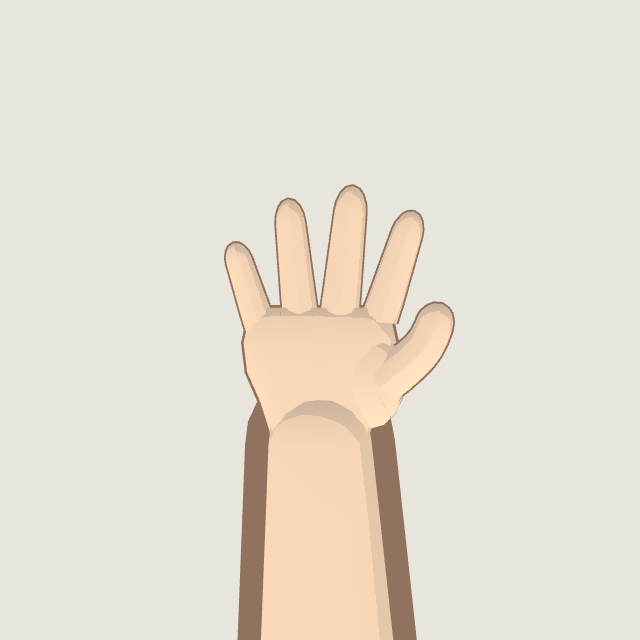
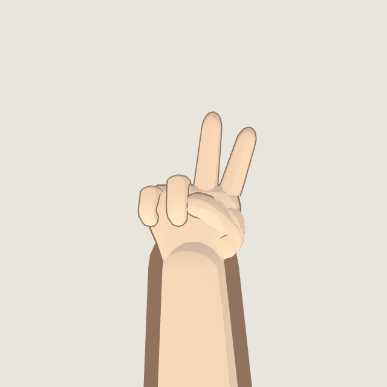
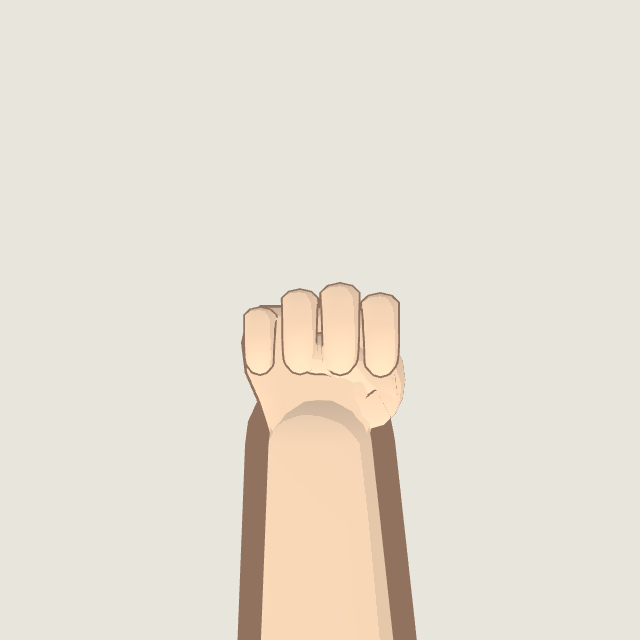
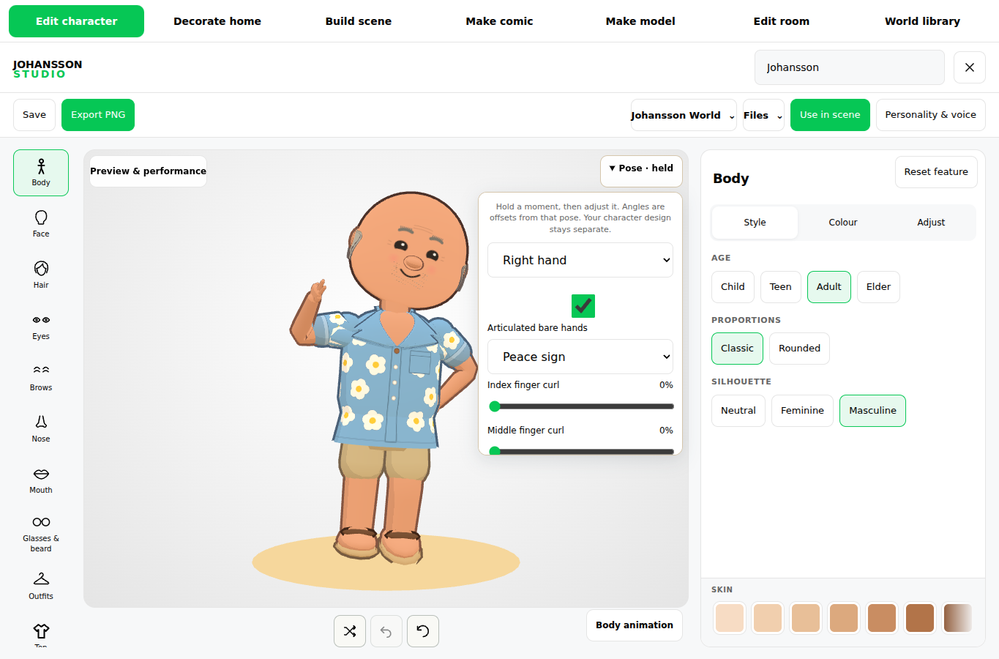
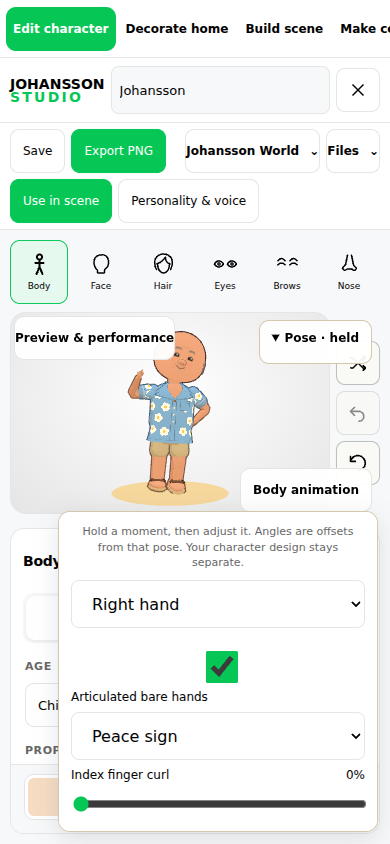
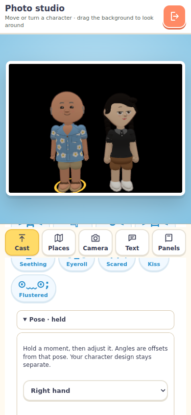

# Bare five-digit hands — verification, 21 October 2026

This is the opt-in hand stage above body-pose PR #300. Implementation and limits: [HANDS.md](../../../../avatar-creator/HANDS.md).

Passed:
- 40 focused tests: optional hand rig, original 28-joint skeleton/index compatibility, five digits, skin-colour match, mesh-count parity, geometry budget, finite/normalised skin weights, presets and independent ring curl, repeated application without drift, legacy/new pose files, all preview outfits, avatar/motion/scene/performance regressions and runtime packaging.
- Full World runtime build, preserving the existing loading/dependency checks.
- Existing body-pose browser regression.
- New hand browser test: shared controls, undo/redo, original-hand fallback, pose transfer, actual Studio scene persistence and World Photo Studio, desktop/phone layouts, posed GLB export and reload. The loaded GLB retained all 56 joints and the selected ring-finger rotation.
- Visual review of the actual Studio UI and isolated open/peace/fist hand surfaces. Gesture close-ups remove other body triangles in a diagnostic view, so the leg cannot hide the hanging hand; this does not change production geometry.

The screenshots use headless Chromium with SwiftShader. Physical iPhone/iPad Safari, hardware frame-rate measurements and full-game navigation remain unverified. Normal gameplay avatars are unchanged. Presets are static finger configurations; no finger-motion timeline, imported finger tracking or automatic prop grips are claimed. Studio provides posed GLB export; World provides pose files and photographs.

## Shape revision following visual review

The first screenshots were rejected by the owner for their appearance. This revision replaces the circular palm with a flattened, tapered palm, rounds and tapers the finger tips, blends finger roots and changes thumb opposition. The optional forearm now narrows at the wrist; its former rounded end obscured the palm. Legacy geometry remains unchanged. Close-ups now include the attached forearm and face upright.

The revised source passed the 37 geometry, pose, avatar, motion, scene and performance tests, the three runtime-package tests, the full runtime build and the hand browser suite (controls, persistence, GLB round trip and both layouts). These are revised previews, not a claim of final visual approval.
