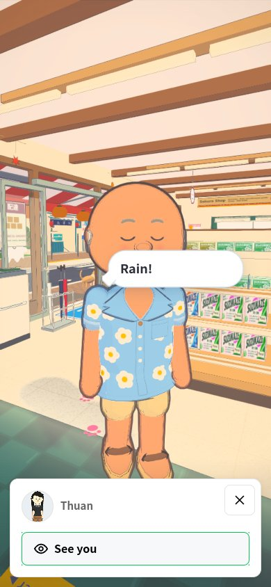
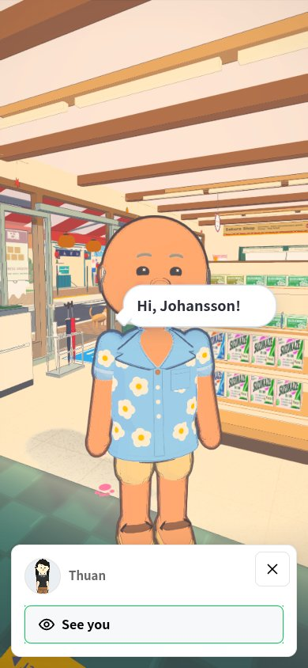
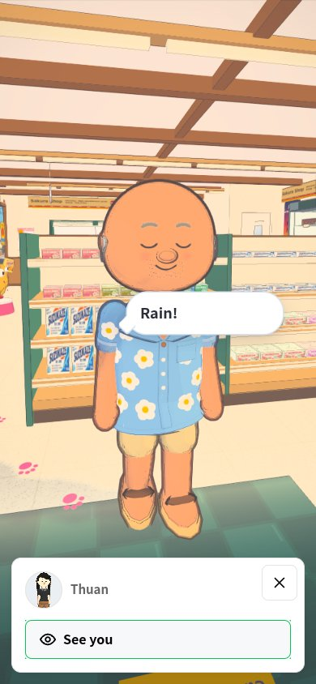
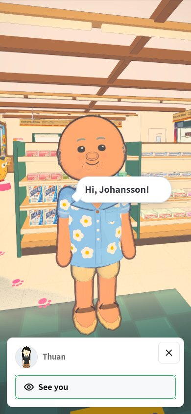

# Johansson conversation eyes: actual-game review

24 October 2026. Fix: [PR #386](https://github.com/nj22az/nj22az.github.io/pull/386),
source/runtime commit `d1ed2d5885189d601e271b767778c9d50b338fdb`.

## Comparison

The original game freezes the `content` greeting face for the entire conversation.
The correction uses an open-eyed smile and advances the player animation while
movement remains paused. Default closed-eye gestures elsewhere remain available.

| Original main | Corrected build |
| --- | --- |
|  |  |
|  |  |

These are captures of the actual Sakura conversation, not generated illustrations.
The harness selects a customer-side position where the normal camera keeps Johansson
visible and places a clear inspection camera in front of him. It does not force actor
visibility. The phone-sized and desktop checks run in software Chromium; no physical
phone, iPad, Steam Deck or hardware performance result is claimed.

## What is checked

The reports preserve 160 facial samples over eight simulated seconds, then 44 speech
samples after selecting a real dialogue reply. Each sample records the expression,
blink, mouth state, visible body, camera distance, position, head and legs.

Checks cover the open-eyed greeting, greeting expiry, blink closure/reopening, mouth
movement, stationary player position, visible actor, absence of walking in place,
retained conversation pause, and the ordinary inventory's animation pause. The
baseline is expected to fail the first four checks; its report is a reproduction.

The script and the game use the same simulation steps for both builds. The ordinary
camera first establishes a visible player; the inspection camera is then used only
for the photographs. Ambient store life can vary between sessions.

## Reproduce

From `johansson-town/`, with a local software Chromium available:

```sh
TOWN_CHROMIUM_PATH=/path/to/chromium node tools/conversation-eyes-smoke.mjs --only=phone --baseline=aee7515f53817cb743c820607baf2e8c6d6a27ab docs/qa/conversation-eyes/before
TOWN_CHROMIUM_PATH=/path/to/chromium node tools/conversation-eyes-smoke.mjs docs/qa/conversation-eyes/after
```

The baseline serves the original main index and its retained compiled chunks. For a
later checkout after those chunks have been pruned, add `--source` to use the baseline
`game.js` and `actors.js` instead. Run this browser alone, without a local test suite.

## Repository checks

The runtime build and five focused test files passed. The original full guard ran
71 files: 69 passed and two lacked fixtures omitted from the sparse checkout.
After restoring the tracked Izakaya source plans and compact-room browser report,
both affected test files passed without source or assertion changes. The logs here
preserve both that first invocation and the successful reruns. See the linked handover
for verified GitHub check status and publication state.
