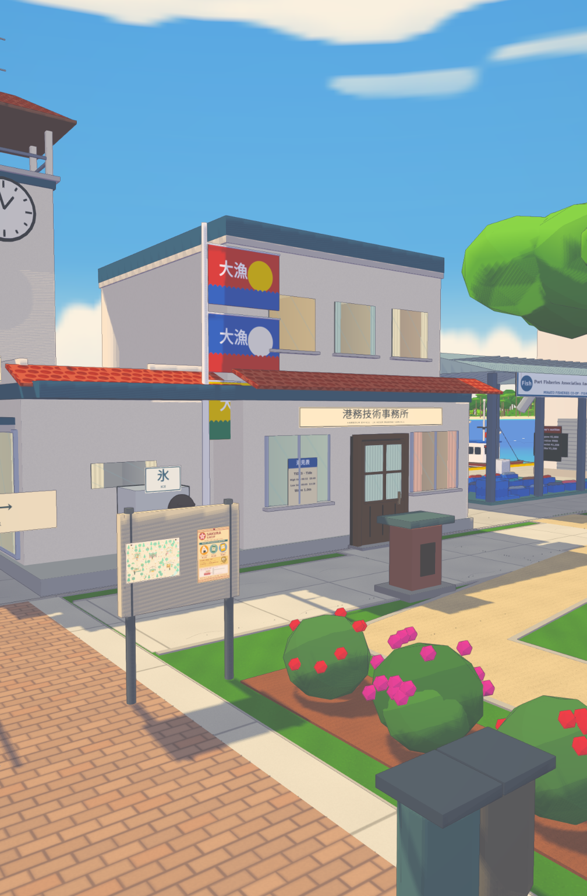
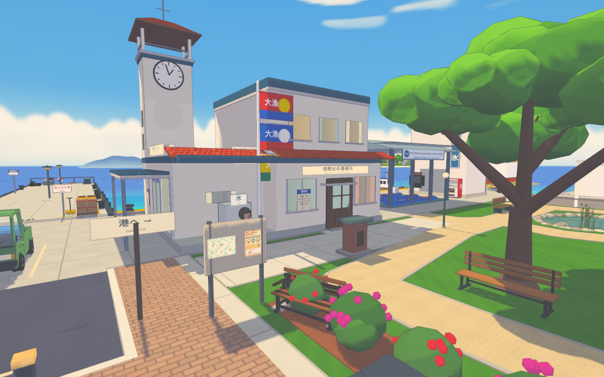
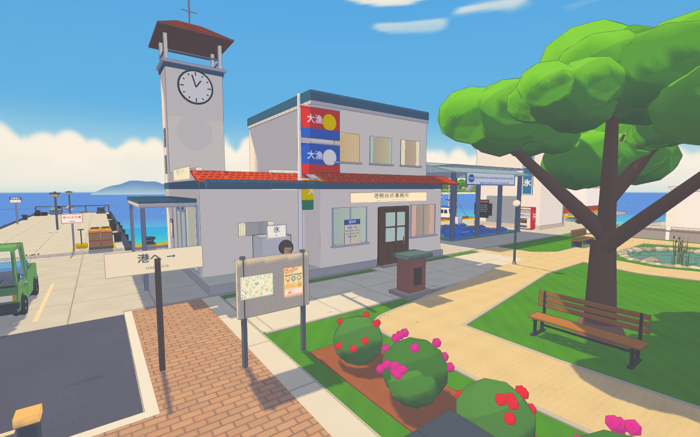
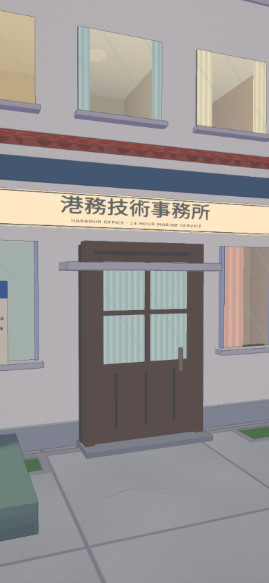
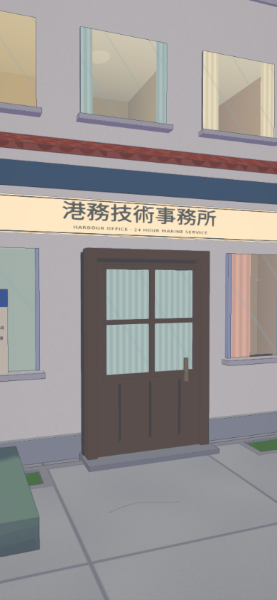

# Ferry office frontage — before and after

Actual compiled-game captures at matching cameras and noon lighting. The bench intersecting the flowering shrubs and the small projecting hood above the office door are removed. The harbour notice board, woodland poster, shop flyer and 3D viewer remain.

| View | Before | After |
| --- | --- | --- |
| Portrait frontage, 1008 × 1536 |  |  |
| Desktop frontage, 1440 × 900 |  |  |
| Doorway, 390 × 844 |  |  |

The before build is published main `7356f64ad017afa2e38e41403ecbcd3fd83b1e09`. The after build includes the selective bench/hood removal and old-opening/checkpoint recovery, while retaining the newer poster integration. Each set has a machine-readable `report.json` recording runtime stability, object/prompt state and page errors. The after report additionally checks that Look opens the woodland viewer and Close returns to World.

Reproduce from `johansson-town/`, running alone:

```sh
TOWN_CHROMIUM_PATH=/path/to/chrome node tools/ferry-office-frontage-photos.mjs docs/qa/ferry-office-frontage/before --before
TOWN_CHROMIUM_PATH=/path/to/chrome node tools/ferry-office-frontage-photos.mjs docs/qa/ferry-office-frontage/after
```

Software WebGL and emulated viewports; physical-device acceptance is not claimed. See [the handover](../../../briefs/HANDOFF-FERRY-OFFICE-FRONTAGE-2026-10-24.md) for checks and publication state.
