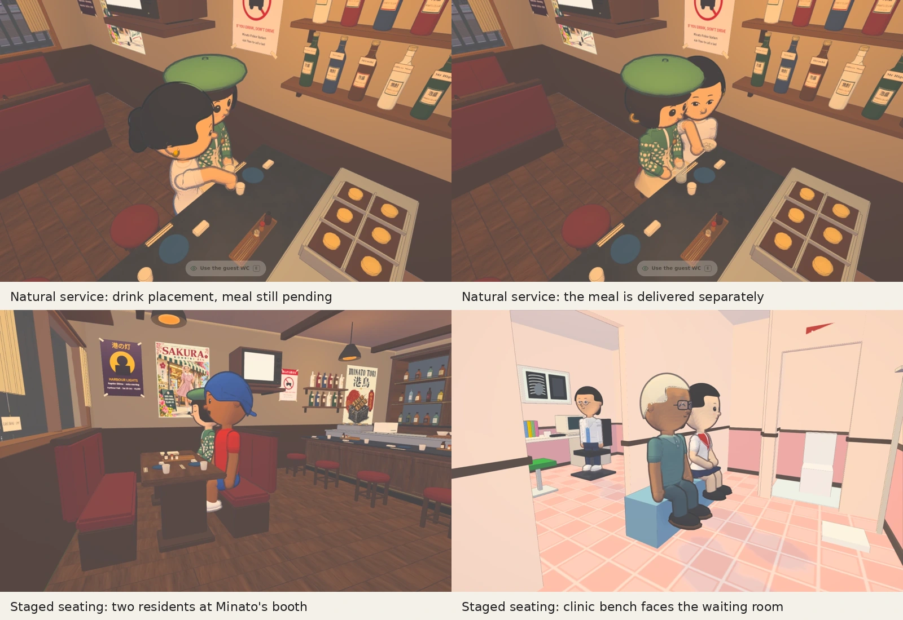

# Food service and seating integration — 22 October 2026

## Scope and sequence

Main inspected: `96a0f83583bb8f10c379f2640cd0216fd4294faa`. PR #350 was already owner-approved and squash-merged as `16407e2822ce2379fb0661042d2c21ddd7334c8d`; its signed handover is on main. PR #351 remained open at `5364c8c4d1cfc33a4cd45c5ba69a4c2c13bc97cb`, with no discussion or review entries on either PR. PR #351 reports conflicts against this newer main.

Integration branch: `codex/food-seating-integration`. Main is the base; the seating branch is combined into it. The 13 shared paths comprise one source file (`src/people/izakaya-beer.js`), `index.html`, `sw.js`, runtime metadata and generated chunks. The shared source preserves food preparation, separate food/drink callbacks, serving routes, close-up collision radius and prop spacing, and adds the measured stool and booth front edges. No food-service source was replaced with the older seating branch's copy.

The runtime conflicts are discarded as generated output; main's runtime manifest and page are used as the previous published generation, then `npm run build:runtime` builds the combined sources, regenerates page references and the service-worker stamp, and prunes old chunks according to the existing builder. This retains its normal previous-generation cache compatibility.

The drinking regression fixture now includes `seatFront: seat.front`: all seven seats' glass, wrist and mouth checks exercise the new posture. The seating photograph tool gains `--runtime` and `--desktop`, and records capture conditions, so the same built runtime can be reviewed at both viewport sizes.

## Acceptance and limitations

The combined runtime passed the following checks (counts overlap; they are not added together):

| Check | Result | Record |
| --- | --- | --- |
| Repository guard, including z-fighting, seat contact, indoor access, food and drinking | 336 passed, 60 files | [guard.log](guard.log) |
| Food, partial-delivery restoration, cancellation, collision, drinking with seat-front measurements, grip, save safety/feedback and onsen chair | 68 passed | [extra.log](extra.log) |
| Web-edition food, collision and resident-personalities checks | 30 passed | [web.log](web.log) |
| Rebuilt runtime packaging | 3 passed | [package.log](package.log) |
| Runtime build, script syntax and source diff whitespace | Passed | Runtime source hash in [acceptance.json](acceptance.json) |

No gameplay integration defect was demonstrated by these checks. The shared sources combined without losing either feature. A capture-tool framing defect was corrected: the ray check now ignores staged figures and hidden ancestors, the camera angles give the sitters more room, and the report records camera positions. The added drinking-fixture data closes an integration-coverage gap. Source-only whitespace checks pass. The full staged diff reports pre-existing embedded-GLSL whitespace in #351’s generated `runtime/compact-shops-M6EJ8ghC.js`; the generated shader text is preserved, not hand-edited.

Existing #351 exclusions remain: fixed-pose figures such as the clinic doctor and old comic backdrops were not converted to measured front-edge seating by that PR. Its pre-existing Higa Liquor bench edge discrepancy is not changed here. These are not claimed fixed by the integration. Software Chromium is not physical iPhone/Safari, native Linux/Electron or Steam Deck acceptance. Staged seating photographs must be identified separately from naturally simulated food-service captures. No merge, Pages publication or Linux release is authorised by this integration review.

## Actual-game evidence



All views use the rebuilt runtime through the actual game's audit harness. Desktop is 1280 × 800; phone-sized is 390 × 844. Screenshots are converted to WebP for the review packet. They are still images, not continuous-animation or physical-device acceptance.

| Evidence | Capture conditions | Links |
| --- | --- | --- |
| Thao puts down the drink; customer receives it while food is pending | Natural simulation, full Linux-edition budgets | [Desktop placement](desktop/drink-placement.webp), [drink first](desktop/drink-first.webp), [phone placement](phone/drink-placement.webp) |
| Preparation, plating, collection and carrying | Natural simulation, full Linux-edition budgets | [Range](desktop/range.webp), [plating](desktop/plating.webp), [collection](desktop/collection.webp), [carrying](desktop/carry.webp) |
| Thao places the separately prepared meal | Natural simulation, full Linux-edition budgets | [Desktop placement](desktop/food-placement.webp), [meal received](desktop/food-served.webp), [phone placement](phone/food-placement.webp) |
| Interface remains within the viewport | Normal HUD visible; separate full-simulation and web-edition captures | [Desktop HUD](desktop/hud.webp), [phone/full simulation HUD](phone/hud.webp), [phone/web HUD](web-phone/hud.webp) |
| Phone web edition delivers drink before food as well | Natural simulation with normal web budgets | [Drink placement](web-phone/drink-placement.webp), [drink first](web-phone/drink-first.webp), [food received](web-phone/food-served.webp) |
| Minato stool and two-person booth | Staged real residents, real seat data and animator, actual game room; not a schedule test | [Desktop stool](seating-desktop/minato-stool-side.webp), [desktop booth](seating-desktop/minato-booth.webp), [phone stool](seating-phone/minato-stool-side.webp), [phone booth](seating-phone/minato-booth.webp) |
| Clinic bench faces the waiting room; police bench seats two | Staged real residents, actual game rooms | [Clinic](seating-desktop/clinic-bench.webp), [police station](seating-desktop/police-bench.webp) |

The [desktop](desktop/sequence.json), [full-simulation phone](phone/sequence.json) and [web phone](web-phone/sequence.json) traces each record `drinkDelivered=true, foodDelivered=false` before the meal arrives and `foodDelivered=true` afterwards. No captured rice-eating state precedes food delivery. [Machine-readable service acceptance](service-acceptance.json) records those checks. Seated-camera reports are in [desktop](seating-desktop/report.json) and [phone](seating-phone/report.json).

The desktop and web-phone HUD frames were visually inspected: the location chip, guide button, speech balloon and action pill remain within their viewports. This is a representative layout review, not exhaustive touch, rotation or Safari acceptance. An onsen close-up and initial paired phone-bench views were rejected for cropping; they are not supplied as approval evidence. The full seating and contact tests still cover the onsen and the other seats.

Reproduce from `johansson-town/`, setting `TOWN_CHROMIUM_PATH` to the installed Chromium executable:

```sh
node tools/izakaya-food-look.mjs output/food-integration-desktop --details --linux --desktop
node tools/izakaya-food-look.mjs output/food-integration-phone --details --linux
node tools/izakaya-food-look.mjs output/food-integration-web-phone --details --only drink-placement,drink-first,food-served
node tools/seated-interior-photos.mjs output/seats-desktop --runtime --desktop '--only=^(clinic-bench|police-bench|minato-stool-side|minato-booth)$'
node tools/seated-interior-photos.mjs output/seats-phone --runtime '--only=^(minato-stool-side|minato-booth)$'
```

Run browsers alone. The natural service fixture uses a fixed audit clock at 20:15 to keep the customer present while its state advances; staged seating frames hide the naturally scheduled residents and pose the named recipes on the real seats.

## Review sequence

1. Review this combined runtime's tests and actual-game pictures with the owner.
2. After explicit visual approval, recheck main and both PR heads. If main moved, integrate and rebuild again, rerun relevant checks, and refresh affected evidence.
3. Merge the combined change only with the owner's approval and a green hosted World guard. Once that integration is on main, reconcile PR #351's now-included content rather than merging its old generated assets separately.
4. A new Linux release and physical-device acceptance remain separate work.
