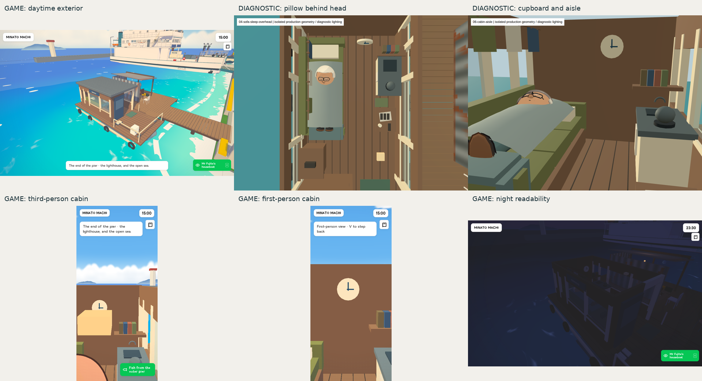

# Shiosai visual audit



[Full findings and limitations](Shiosai-Audit.txt)

- `game/`: exterior, stern, sleeping, gangway, harbour and wake-return game views, plus the original capture report.
- `camera/`: corrected first- and third-person cabin views and their report.
- `geometry/`: production boat and resident under fixed diagnostic lighting. These are not the game’s lighting or rendering treatment.

## Result

The pillow position, opaque futon cupboard and obstructed third-person cabin composition need correction. Night-time legibility also needs review. The exercised walking route, overnight routine and roof cutaway passed. The game source is unchanged by this audit publication; visual acceptance remains open.

## Provenance

Game commit: `a42fad65dc19c577f7f9b5707be152618aa92180`.

Runtime source SHA-256: `f06fde681f926d2725622a9d6146dc8c55845553f77e31886460eaa7f6ee5c68` (matched to the deployed stamp during the audit).

Capture runs: [full game](https://github.com/nj22az/nj22az.github.io/actions/runs/39152409753), [diagnostic geometry](https://github.com/nj22az/nj22az.github.io/actions/runs/39152996601), [corrected cameras](https://github.com/nj22az/nj22az.github.io/actions/runs/39153372104).

The phone-sized images use Chromium mobile configuration and an iPhone user-agent. No physical iPhone, Safari/WebKit or measured frame-rate acceptance is claimed. Four initial staging/camera captures were rejected; their records remain in the original report for transparency, while their images are omitted.

## Capture tools

With the project’s Playwright dependency and Chromium installed, run from `johansson-town`:

```
node tools/capture-sofa-houseboat.mjs
node tools/capture-sofa-geometry.mjs
```

The first captures stable normal camera views and sleeping overheads; the second captures geometry close-ups. These inspection harnesses use temporary local previews and do not alter the shipped game. The one-off branch capture workflow was removed before merging.
