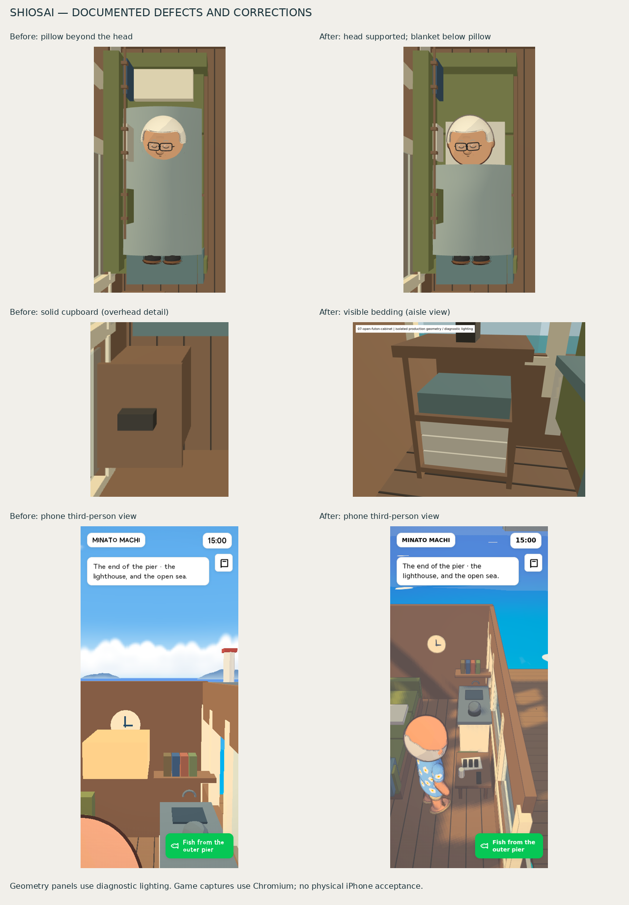

# Shiosai visual corrections — 19 October 2026



This corrects the three implementation defects in the [18 October audit](../visual-audit/Shiosai-Audit.txt). The earlier audit remains a historical record of its tested build.

## Corrections and evidence

| Finding | Correction | Evidence |
| --- | --- | --- |
| Pillow beyond Fujita's head | Move its centre from local z = −2.56 m to −1.925 m. Its bottom settles 1 cm into the 0.62 m sofa seat, with its top at 0.69 m beneath the animated head. Shorten the sleep cover to the shoulders so the pillow remains visible. | [Overhead](geometry/04-sofa-sleep-overhead.png), [head support close-up](geometry/05-sofa-sleep-close.png), [aisle](geometry/06-cabin-aisle.png); rays against the actual animated head, pillow and sofa in the geometry tests. |
| Futon concealed by a solid block | Replace the body with a back, two sides and two shelves. The front opens towards the aisle, within the previous cabinet and collider footprint. The three futon folds and quilt rest on their shelves. | [Diagnostic opening](geometry/07-open-futon-cabinet.png), [phone game view](camera/phone-open-cabinet-day.png), [desktop game view](camera/desktop-open-cabinet-day.png); sight rays reach all four bedding layers before any wood. |
| Cramped third-person composition | Within the cabin, use a raised downward view with a 2.15 m boom on desktop and 2.838 m in portrait. The roof-mounted lamp and overhead doorway lintel follow the roof cutaway. The existing close-wall head-camera fallback also applies here. Raw player yaw/pitch are retained for first-person view and exterior restoration. | [Phone before/after](comparison.png), [desktop third-person](camera/desktop-normal-cabin-camera.png), [first-person](camera/desktop-alternate-cabin-camera.png), camera probes and walking checks in [the raw report](camera/report.json). |

The lamp remains off while Fujita sleeps. A small material fill on the sofa, bedding and cabin lining improves their night silhouettes without adding lights or render targets. Night views remain deliberately dim: inspect [desktop third-person](camera/desktop-third-person-night.png), [phone third-person](camera/phone-third-person-night.png), [desktop head support](camera/desktop-sleep-side-night.png) and [phone head support](camera/phone-sleep-side-night.png).

## Verification and provenance

Game source commit: `ab31811c3e4376b90f03a52cb53a9fb1dcad4b0f`.

Runtime source SHA-256: `e96090a0e80f56b3c48a0007050bd45bdb7460883f75291cbd7d3842827149f4`.

The connected GitHub source commit matched the local game and runtime. The runtime, page references, manifest, service worker and reusable houseboat GLB were regenerated. Previously published runtime files are retained for cached pages. The evidence commit only adds documentation, captures and capture-tool adjustments; game-source files are unchanged.

[38 automated checks](tests.txt) pass, covering head support, visible bedding, roof fittings, batching, both directions of the gangway/cabin route at a 0.28 m player radius, overnight and reverse-clock routines, cargo clearance, indoor camera ceilings, lens obstruction, renderer safeguards and runtime packaging. The model with its sign has 29 meshes, within its existing batching test. Collider shapes, walking surfaces, bed anchor, routine hours and save schema are unchanged.

The full-game inspection uses the compiled runtime in Chromium headless shell with software WebGL, at 1280 × 800 and 390 × 844. The phone context uses mobile/touch configuration and an iPhone user-agent; movement and looking in this run use keyboard/mouse automation. Google Fonts CSS is stubbed; local fallback fonts are used. The diagnostic images use production geometry with separate fixed lighting and are labelled accordingly.

Both viewport runs pass: 16 full-game screenshots, seven diagnostic views, 24 clear camera-lens probes and 16 reached walking waypoints. First-person forward and backward movement pass in each viewport. Inside, all three cutaway groups are hidden; after leaving, the roof, lamp and lintel return, the exterior pitch is restored, and Fujita is back at the shed. The recorded browser, console, asset and request error lists are empty.

The sleep/wake capture staging advances the production shed routine directly. This avoids simulating unrelated town activity for the screenshots; it is separate from the automated full routine checks. Normal first- and third-person views use the actual game camera. The overhead and sleeping side details use explicit audit-camera positions.

The comparison uses the original audit's geometry and camera images. The cupboard comparison deliberately contrasts its old overhead view with the new aisle view, as labelled. The old and current game builds also contain different global rendering revisions; these images demonstrate geometry and framing, rather than isolating overall colour changes or performance.

## Reproduction

From `johansson-town`, with Playwright and a compatible Chromium browser installed:

```sh
AUDIT_OUTPUT=../docs/qa/fujita-sofa-cabin/visual-fixes/camera/ node tools/capture-sofa-houseboat.mjs
AUDIT_OUTPUT=../docs/qa/fujita-sofa-cabin/visual-fixes/geometry/ node tools/capture-sofa-geometry.mjs
```

Set `AUDIT_GAME_COMMIT` to the tested commit. `TOWN_AUDIT_CHROMIUM` can select an installed headless-shell executable where the full browser cannot create its profile socket. [validation.json](validation.json) records the completed checks and evidence hashes.

## Outstanding physical-device acceptance

No physical iPhone Safari or on-device touch test was available. Check the gangway and doorway with touch controls, switching view modes and looking around the cabin by day and at night, plus suspend/resume. Device frame rate, thermal behaviour and long-duration stability remain unverified. Chromium screenshots do not establish those results.
