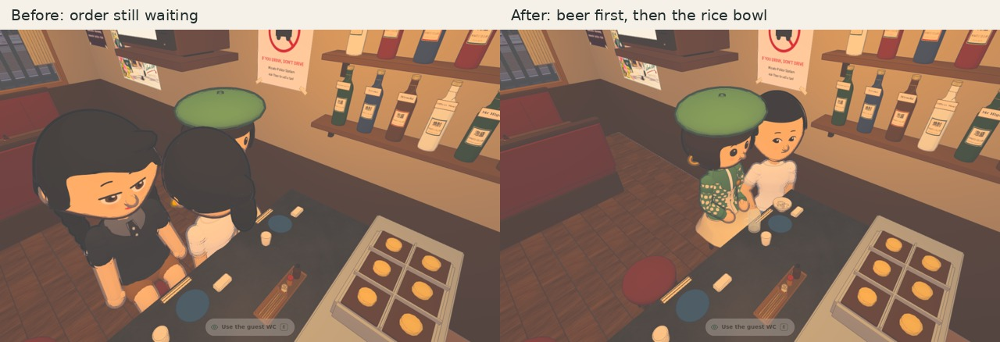

# Minato food service — visual and runtime review

Branch: `codex/izakaya-food-service`. Baseline: main `8e234f1bb407611d37101247eff0f56c1facb5f3`.
Status: draft review, not merged or published; owner visual approval pending.



[Seven sampled interaction beats](service-sequence.gif) — seven actual game captures held for readability, **not a
real-time animation video**. The dish on the counter is the one Thao collected and carried.

## What was captured

- [Baseline, same desktop camera](before-desktop/040.png): the unmodified main source in the running game. Thao is
  held off her serving point by the old uniform body-separation circle. Consequently this baseline does **not** show
  a successful drink/food arrival; it records the integration obstruction discovered during this task.
- [Drink received, food pending](desktop/drink-first.png).
- [At the existing range](desktop/range.png).
- [Plating on the supported worktop](desktop/plating.png).
- [Collecting the prepared dish](desktop/collection.png).
- [Carrying around the counter](desktop/carry.png).
- [Hand and dish at the customer's actual counter](desktop/food-placement.png).
- [Meal received](desktop/food-served.png).
- [Phone-sized plating](final/plating.png) and [collection](final/collection.png), 390 × 844.

The final desktop set is 1280 × 800. Both use the actual game, its real Thao/Nhung recipes and fitted room, software
Chromium and the `?audit&visual-audit` harness, with Linux-edition budgets enabled through the normal edition flag.
This is not a physical Steam Deck or iPhone test and is not a native Electron acceptance run. A fixed evening audit
clock keeps the customer present during inspection. Before and after are independent runs, not identical crowd states.

The source baseline is served from the recorded main commit; final views use the rebuilt runtime. The capture utility
waits for actual preparation, collection and placement states rather than inferring a successful action from a timer.
The [desktop trace](desktop/sequence.json) and [phone trace](final/sequence.json) record the state used for each beat.
Both contain `drinkDelivered=true, foodDelivered=false` before food delivery, and later `foodDelivered=true`.
No trace records a held rice bite before delivery; automated tests additionally advance through the eating sequence.

## Checks

- Final full repository guard: **334 passed**, 60 files, including the geometry/z-fighting and runtime-package guards.
- Final food/contact/routes/save/cancellation/booth-spacing suite: **23 passed**. Every supported food and all seven
  player serving seats are covered; the real Thao rig is used for arm/hand and held-prop checks. The widest plate is
  routed to every seat. All four residents’ booth settings keep dishes clear of the glasses and supported by the table.
- Focused food/drink/service-route regression run: **45 passed**.
- Web-edition food/resident-life/body-collision checks: **35 passed**.
- `git diff --check`: passed.
- Runtime rebuilt; no room/character scaling or new ground geometry. Existing glass, bottle, pour and drinking
  performances are retained. Food and drink props do not overlap at the supported serving positions.
- Extra non-guard ramen-kitchen fixture: an existing removed-resident/profile failure, already identified in the
  World handoff; not repaired in this change.

## Reproduce

From `johansson-town/`, use the installed Chromium path for your environment:

```sh
TOWN_CHROMIUM_PATH=/path/to/chromium node tools/izakaya-food-look.mjs output/food-before --source --before --first --linux --desktop
TOWN_CHROMIUM_PATH=/path/to/chromium node tools/izakaya-food-look.mjs output/food-after --details --linux --desktop
TOWN_CHROMIUM_PATH=/path/to/chromium node tools/izakaya-food-look.mjs output/food-phone --details --linux
```

`--baseline=<commit>` overrides the default recorded baseline. Run browsers alone. For the guard on Node 22, use
`NODE_OPTIONS=--max-old-space-size=6144 node tools/ci-guard.mjs` (the existing z-fighting suite needs the larger heap).
