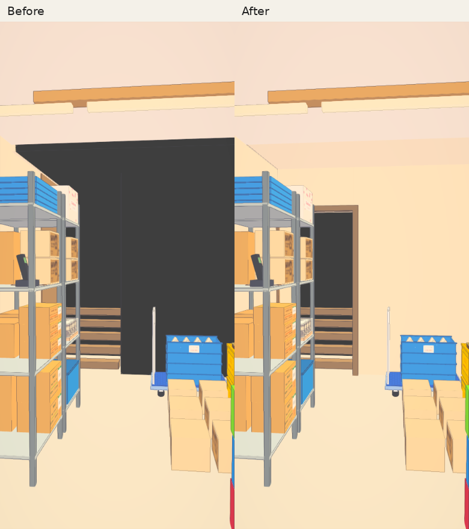

# Sakura stockroom stair entrance — 22 October 2026

This is the actual game, not an isolated room render. The before fixture uses main `a0fb347ced9250b2e5a6210ba068bf595a7ca310` and serves that revision's stair module; the after fixture uses the rebuilt runtime with the proposed entrance. The room, time, weather, camera coordinates and viewport are otherwise matched.

The owner's IMG_8651.jpeg was inspected. Its camera coordinates were not saved; the stockroom comparison reconstructs the same aisle towards the stair. It is not claimed to be the exact original camera or the original deployed revision.



## Geometry

Three black volumes reaching 6.81 m above the stockroom floor have become one recessed black volume below 2.84 m. A timber frame bounds a 1.1 m wide entrance with a 2.35 m head. Plaster encloses the former alcove and a soffit closes the old ceiling opening at 2.98 m. The first five timber treads remain visible. Walls, linings and soffit have matching collision volumes. Their visible faces do not share a plane.

The transition path, timing, triggers, prompts, arrivals, office geometry, inside-only access and fire escape are unchanged. No other quality-recovery work is included.

## Captures

Required phone viewport: 390×844, device scale 1. Additional 1280×800 desktop and 844×390 landscape. Software Chromium/SwiftShader, fresh browser storage, web edition, sunny, 22 October at 12:20 (town minute 424100). See the JSON reports for the exact fixture, positions and checks. Browser emulation is not physical iPhone Safari acceptance.

| View | Camera position | Look at |
| --- | --- | --- |
| front / landscape / down-arrival | 0.4, 1.6, -5.6 | -2.7, 1.4, -4.8 |
| side | 0.15, 1.6, -6.15 | -3.2, 1.35, -4.8 |
| low | -0.85, 0.65, -5.75 | -2.7, 1.1, -4.6 |
| stockroom / third-stockroom / desktop-stockroom | 3.9, 1.6, -5.75 | -3, 1.4, -5 |
| up-arrival | -1.2, 1.6, -3.95 | -1.2, 1.45, -1 |

Additional matched comparisons: [front](front-comparison.png), [side](side-comparison.png), [low](low-comparison.png). Unmodified individual PNGs are in `before/` and `after/`. Comparison sheets only add headings and join the originals without retouching.

The four portrait comparisons use identical cameras. The auxiliary before landscape/down-arrival views use the earlier close camera at `0.05, 1.6, -4.6`, looking at `-3.25, 1.45, -4.6`; those auxiliary images are not matched pairs. The four base after views and the remaining after views were captured in two passes with the same rebuilt runtime and fixture.

Reproduce from `johansson-town/`, running browsers and the guard separately:

```sh
TOWN_CHROMIUM_PATH=/path/to/chrome-headless-shell node tools/sakura-entrance-photos.mjs --source --baseline=a0fb347ced9250b2e5a6210ba068bf595a7ca310 docs/qa/sakura-entrance/before
npm run build:runtime
TOWN_CHROMIUM_PATH=/path/to/chrome-headless-shell node tools/sakura-entrance-photos.mjs docs/qa/sakura-entrance/after
```

The script tests both prompt directions and walking onto both triggers, records fade activation, checks player and camera clearance on arrival, and asserts third-person mode. `--checks-only` skips PNG captures.

## Validation

- Runtime build: passed.
- [CI guard](ci-guard.txt): **347 passed, 0 failed, 64 files**, 177 seconds.
- [Runtime package](runtime-package.txt): **3 passed**; generated runtime matches current source and its hashed dependencies.
- [Stair regressions](sakura-stairs.txt): **6 passed**, including player-radius reachability, recessed-darkness rays, closed ceiling and unchanged transition wiring.
- [Z-fighting](no-z-fighting.txt): **13 passed**, including the complete stockroom stair and office; no tolerance/exclusion changes.
- Upstairs, enterable-sites and ground-standard checks pass in the guard. Ground baseline remains empty.
- Actual rebuilt game: **8 safe transition checks**, prompt/automatic × up/down × first-/third-person. Fade activation, correct room/arrival, no blocked arrival or camera, zero page errors. [Third-person report](after/report.json), [first-person report](first-person/report.json).
- `git diff --check`: passed.

The source stair blob is `712fad96930f68ae125078807ace90feb3db9c93`; runtime source SHA-256 is `eab03861ea7a9ebd110e1d75ffb5bdd696bb8c32175dbc9b1bdd845bbd33ab4a`.

## Review state

Proposed correction only. Owner visual approval is required before merging. No deployment, Linux package release or physical-device acceptance is claimed.
