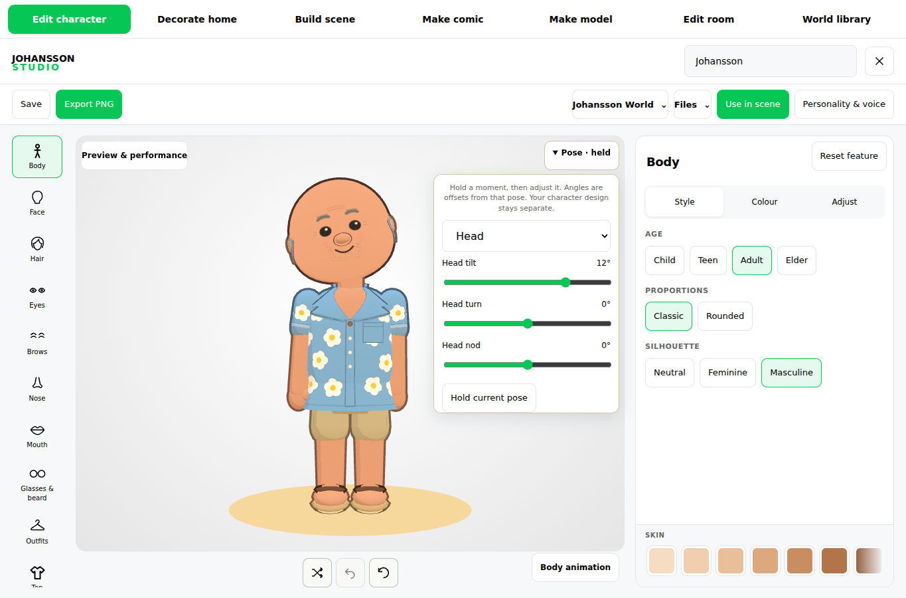
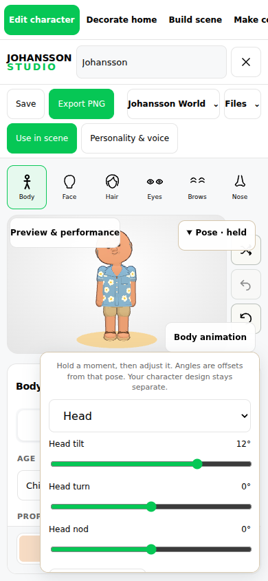
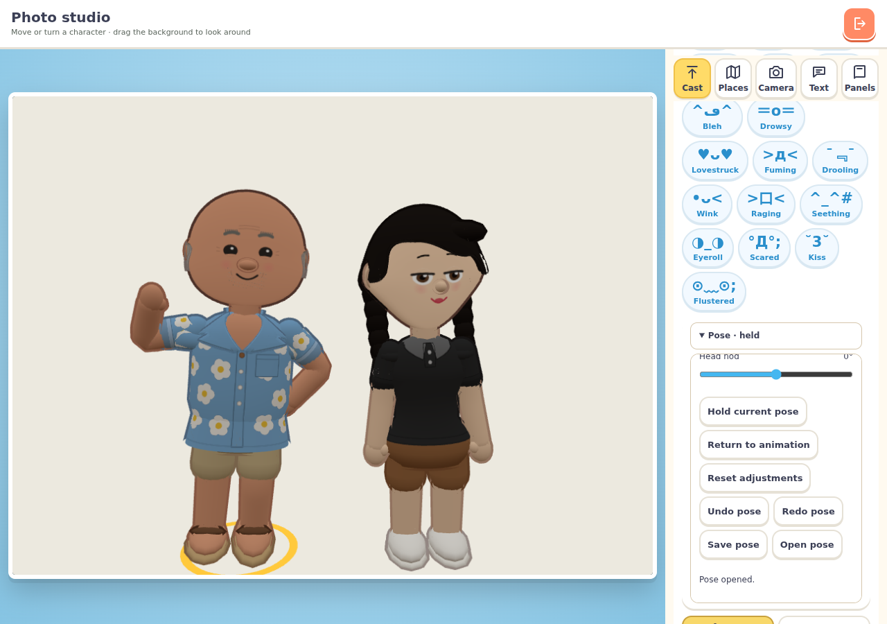
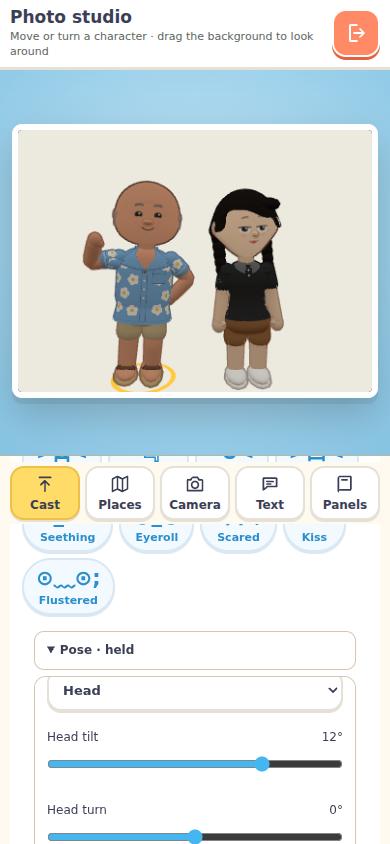

# Shared pose controls — validation, 21 October 2026

Implementation: shared `avatars/pose.js` and `pose-panel.js`, used by Studio's character editor and World's native Photo Studio. Existing skeleton, skin weights and appearance recipes are unchanged.

Passed:
- 28 focused tests: new pose invariants and file validation, motion transfer/import, performance state, scene snapshots/motion and runtime packaging.
- Separate existing avatar customisation, gait and floor-contact checks completed in the earlier 28-test run with no failures.
- Full `npm run build:runtime`, followed by runtime-package verification. Previously published main chunks are retained for cached pages.
- `POSE_CHROME=/tmp/chromium node avatar-creator/tests/pose.browser.mjs`: shared creator controls; mirrored wrist editing; undo/redo; pose-file download/reopen and invalid-file rejection; frozen PNG consistency, including stopping the walking preview's automatic turn; appearance/proportion rebuild; imported-motion handover; actual Studio scene round trip; native World Photo Studio receiving Studio's pose file; return to town.

Screenshots use headless Chromium and SwiftShader. Studio: desktop 1365×900 and phones 390×844 / 320×568. World Photo Studio: 1280×900 and 390×844, using its native module in a small test scene. These are not full-game navigation, hardware GPU or physical iPhone/iPad Safari checks.

Manual offsets do not solve prop, clothing or furniture collisions. T-pose/animated GLB export remains unchanged. Hand geometry and finger animation are deferred; the recorded preference is bare hands with four fingers and a thumb.

