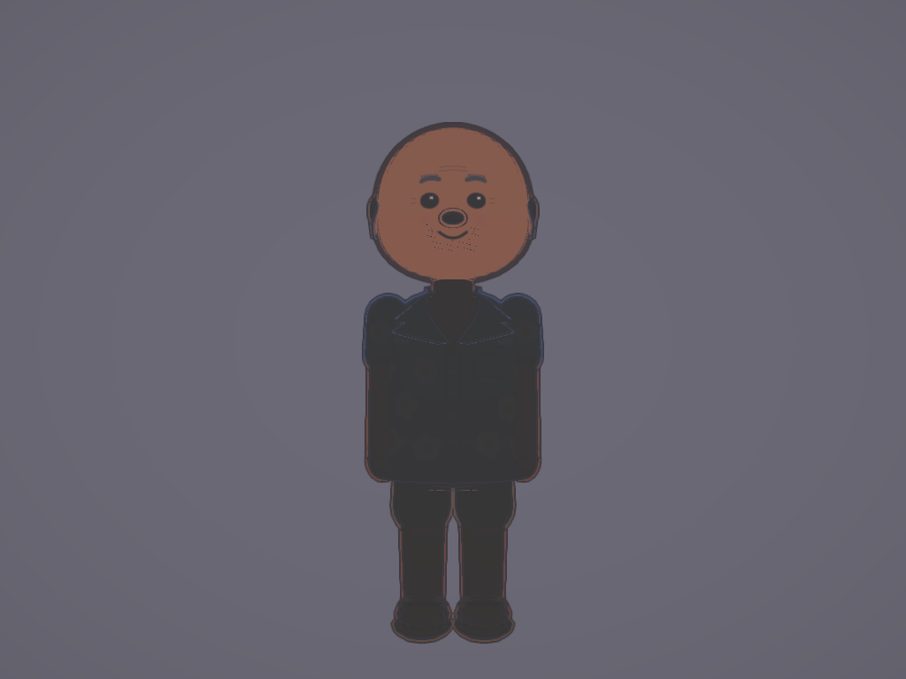
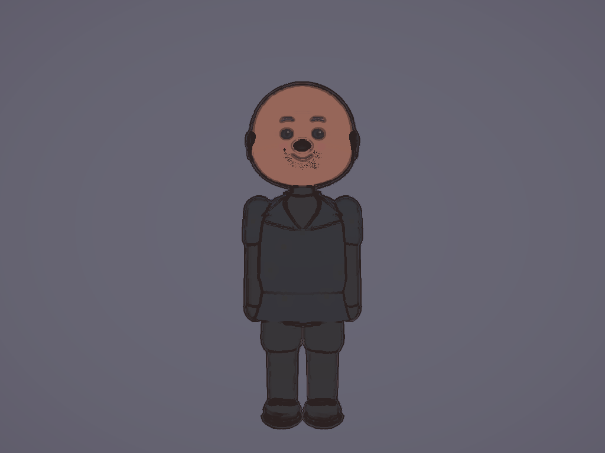
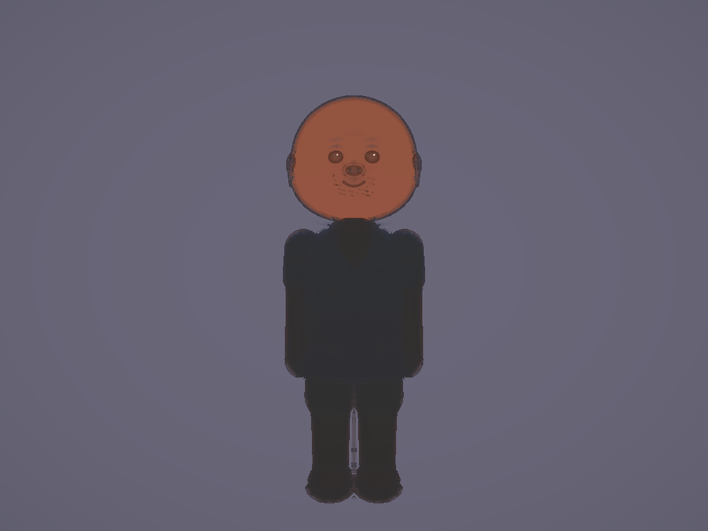

# Linux 0.2.20 — acceptance and publication

25 October 2026 (Europe/Stockholm).

[Published release](https://github.com/nj22az/nj22az.github.io/releases/tag/johansson-world-linux-v0.2.20) · [Release workflow](https://github.com/nj22az/nj22az.github.io/actions/runs/40163244813) · [Complete candidate acceptance](https://github.com/nj22az/nj22az.github.io/actions/runs/40161672630) · [World guard](https://github.com/nj22az/nj22az.github.io/actions/runs/40161672636)

Includes the production facial-rendering correction: painted eyes, brows and other dark marks retain contrast in dim lighting; Sketchbook preserves them through its paper wash. Character geometry, facial animation, controller implementation and save locations are unchanged. The Steam Library installer, Deck Gamepad with Camera Controls layout and saved-axis fallback are retained.

## Source and review identity

- Facial correction on production main: `c36a40c782ae9ffa118b879661849e9a6f1af01e`, documented in `a7338203dd8a239fb6529e533aaea23a9526d651`.
- Production snapshot frozen from main: `aa792244c914eec604b0aac4e5fb18ccaa4119cd`; its World source is unchanged from the initially validated candidate `344dc5d5`.
- Final reviewed candidate, [PR #397](https://github.com/nj22az/nj22az.github.io/pull/397): `2c504ee0ad9e83d411a309fa0dcbbc89b223380d`.
- Tested PR merge: `87200e65351f68edb84ebf3c6029fec87eddc0a1`.
- Published release merge and immutable tag: `a56db3686b853907f08335c88e0197b96b972b47`.
- Candidate/test-merge/release tree: **`156956a70be12d3f49026df6615a982ca8bd5167`**, identical. The final package's `desktop-build.json` identifies the published merge, version 0.2.20 and offline mode.

The existing Linux preparation branch was reused; no new branch or prototype promotion. The older 0.2.19 release and asset digests are unchanged. Concurrent later main changes, including NPC-social work, remain on main and are outside this explicitly frozen package; they are not overwritten by the website/evidence integration.

## Checks completed

- **World guard: 413/413, 80 files.**
- **Desktop regressions: 39/39**, including controller normalisation/remaps, storage/updater compatibility, Steam shortcut and Gamepad layout preservation, backups and idempotent installer use.
- **Packaged facial rendering: 92 actual WebGL cases across all 19 Looks**, dim/day light at 390×600 and 1024×768, plus repeated switching. Both the candidate and final release pass. Minimum measured eye contrast **0.0646**, threshold **0.045**. The actual packaged shared-avatar, Look/pipeline sources and runtime modules are checked against production bytes before rendering. Four dim captures from the final release are byte-identical to the reviewed candidate.
- **Controller recovery**, actual Electron startup, peaceful-world checks, disk save creation and **offline startup with remote requests blocked** pass on both candidate and release.
- **Full candidate controller/layout/save acceptance passes**: actual player movement and camera yaw/pitch, four window sizes, pad-family prompts/remaps/reconnect, live-cast switching/owned homes, conversations, retained character/control settings after reload, and safe recovery of old combat/cave saves. Final result: **zero page errors, zero missing packaged files**. This is software input simulation.
- Production runtime rebuild reproduces `boot-Dxv7PTWJ.js`; no production game/render source was changed by packaging.
- Final release workflow passed through publication and public installer/checksum verification.

## Published artifact verification

Every asset was downloaded from the final release. Sizes and SHA-256 agree with GitHub asset digests, `SHA256SUMS` and `latest-linux.json`. All **1,621 archive files** and their modes match the bundle inventory. The app version, immutable source identity, installer copies, shared avatar/filter sources and **32 packaged runtime JavaScript modules** were independently verified. The 0.2.19 patch's base/runtime identity, exact changed-file payload and target inventory agree with the final full package.

| Asset | Bytes | SHA-256 |
| --- | ---: | --- |
| johansson-world-linux-x64.tar.gz | 268,577,860 | `cede4a0676caecc579397e17baa016e251ab0203bb51e6dedcf53bdb6a2a7199` |
| johansson-world-linux-0.2.19-to-0.2.20.patch.tar.gz | 1,671,472 | `b42c1b59c0c59160dd4b8a1d72850df9d71ab71a98c594177be8a9f41bbe1f42` |

**Actual 0.2.19 → 0.2.20 update:** the updater from the checksum-verified published 0.2.19 archive selects and applies the published **1,671,472-byte patch**. Its result matches all 1,621 files of the final full package; current/previous links switch correctly, the old installation remains byte-identical, and an explicitly synthetic retained save profile is unchanged. The test uses a local transport of verified published bytes in a private temporary directory, with normal non-root tar ownership behaviour; no physical application launch or real user save is claimed. [Actual patch result](qa/0.2.20/actual-patch-result.json).

[Complete machine-readable verification](qa/0.2.20/published-verification.json) · [Checksums](qa/0.2.20/SHA256SUMS)

## Representative screenshots

These are real software-rendered captures. The four face views are a deliberately dim stress fixture served from the final packaged app; they are not reconstructions of island lighting. Gameplay/layout captures use the complete frozen candidate's packaged Linux runtime, whose production game tree matches the release.

| Natural | Sketchbook |
| --- | --- |
|  |  |

| Cartoon | Oil |
| --- | --- |
|  |  |

[Actual packaged gameplay](qa/0.2.20/linux-gameplay.png) · [1280×800 controller layout](qa/0.2.20/controller-layout-1280x800.png) · [92-case measurements](qa/0.2.20/filter-report.json) · [Full-console result](qa/0.2.20/console-results.json)

## Earlier runs and correction

PR #396 used main as its head; unrelated hotel-page updates cancelled its incomplete acceptance. PR #397 freezes production on the existing Linux preparation branch.

The first frozen run [40160734741](https://github.com/nj22az/nj22az.github.io/actions/runs/40160734741) passed package/render/controller-recovery/native/offline gates, then exposed a first-entry help fixture race: a fixed 500 ms assertion read Controls while its immediate diagnostic already showed Help open, with no fatal screen. The fixture now waits for the actual Help/menu state before the same assertions, matching the focused controller-recovery test. No game or controller source was changed; the complete corrected acceptance subsequently passed.

Local desktop and focused checks passed. A local full guard had one file-level z-fighting failure; the isolated 8 GB run passed 13/13, while a default 2 GB rerun exhausted its heap. Hosted full guards passed all 413. Local Chromium/native setup was blocked by this environment's Unix-socket restrictions, so hosted Ubuntu/SwiftShader results are the rendering/startup evidence. A local packaging tar retry was also required; only the final hosted release artifacts and verified hashes above are authoritative. An additional real-patch fixture initially acquired temporary transfer files in the working copy (absent from both published inventories); the same updater checks passed in a private temporary directory, without weakening inventory verification.

## Limits and publication follow-up

**Physical Steam Deck and 8BitDo Bluetooth acceptance remain unverified.** Simulated Gamepad input and Steam file-format fixtures do not establish that the owner's hardware problem is resolved. Hardware FPS, battery life, suspend/resume and physical Safari are not verified. Coarse pixel/print Looks retain their sampling limits; this is not a guarantee at every camera distance or expression.

Website download links, installer metadata and current-version references are being integrated only after this release verification. Deployment and live-file sign-off will be appended after publication. Existing historical release entries are preserved.
