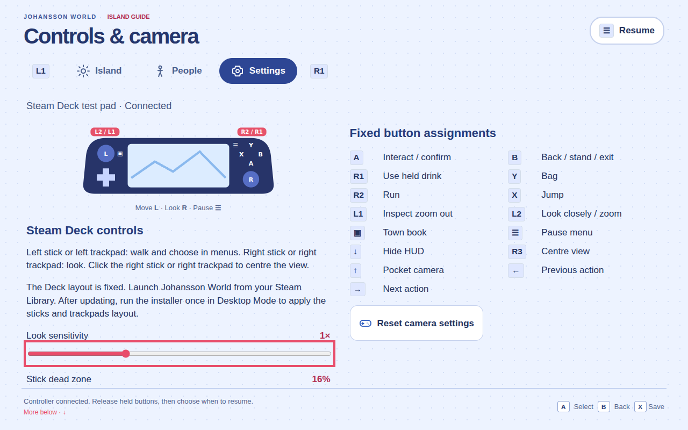

# Linux 0.2.21 — fixed Steam Deck controls

25 October 2026. **Published Linux preview.**

[Release and downloads](https://github.com/nj22az/nj22az.github.io/releases/tag/johansson-world-linux-v0.2.21) · [Reviewed PR #398](https://github.com/nj22az/nj22az.github.io/pull/398) · [Complete candidate acceptance](https://github.com/nj22az/nj22az.github.io/actions/runs/40167683301) · [World guard](https://github.com/nj22az/nj22az.github.io/actions/runs/40167683305) · [Release workflow](https://github.com/nj22az/nj22az.github.io/actions/runs/40169541649)

The owner requested fixed default Steam Deck controls, prioritising its sticks and trackpads over other Linux controller compatibility. The packaged Linux preload now selects `inputProfile: steam-deck`. Axes 0/1 move and axes 2/3 look; buttons and Deck symbols are fixed. Old saved remaps, swapped axes and disconnected controller selections cannot override this profile. Their stored values are retained, together with game saves and camera preferences.

| Deck control | Fixed behaviour |
| --- | --- |
| Left stick / left trackpad | Walk; choose in menus |
| Right stick / right trackpad | Look; right click centres the view |
| A / B / X / Y | Interact or confirm / back or exit / jump / Bag |
| R2 / L2 / R1 / L1 | Run / look closely or zoom in / use held drink / inspect zoom out |
| View / Menu | Town book / pause and resume |
| D-pad | Existing pocket camera, HUD and nearby-action controls; menu navigation |

Steam and Quick Access remain system controls; rear paddles retain their unassigned default. Camera sensitivity, dead zone, FOV, invert Y and walking motion remain adjustable. Axis swapping, button remapping, device selection and symbol-family selection are absent from the shipped Deck controls page. Raw Linux driver guessing is bypassed. Stick-only activity can select a late standard virtual pad beside an idle one. Loss of usable Steam Input pauses even if the raw device entry remains; held buttons on return cannot resume play before release and a fresh press.

## Apply the layout

**Run the current installer once in Desktop Mode after upgrading, then launch through Steam Library → Non-Steam.** Existing installations can run `sh install.sh --steam` to apply the layout without downloading the app again. The in-game updater changes the app but cannot change a running Steam client's input configuration.

The one-file installer embeds an original game-specific template, writes `controller_base/templates/controller_neptune_johansson_world.vdf`, and selects its filename for Johansson World in each account's `configset_controller_neptune.vdf`. Steam closes before these changes. Other games, first-run backups and idempotent repair are covered by installer fixtures. The existing shortcut identity, launcher and save locations remain.

The format was studied in Valve's official [Steam client manifest](https://client-update.akamai.steamstatic.com/steam_client_ubuntu12), version `1792618285`, and `public_all.zip.f7b7316d122d96ff7f79b6eede24edd5b142d7bf` (SHA-256 `c3cf55bac18220f9c3587c91e94777d31968781c76628154794cf15a7de6f6a0`). Neptune templates supplied format evidence for input-source names, modes and activators; standard gamepad templates supplied explicit joystick-output values. No Valve assets or complete templates are redistributed. The original binding document uses joystick movement for both sticks and the left trackpad, mouse-joystick output for the right trackpad, analogue triggers and standard XInput buttons.

## Source and review identity

- Production main frozen at `7c048393daaf614e242956cf3ee7b3f9bdc0f626`; latest published Linux release at preparation was 0.2.20, with no subsequent package.
- Final reviewed candidate: `78965d9ff54cc1907da9a22b4b758d40a7ad2f11`.
- Tested PR merge: `ebd122687321e891f28e66b22cf979e7e05ad123`.
- Published release merge/tag source: `22a03f8ce69a1c0b6241a1fe4cbe14f79b53577e`.
- Identical candidate, test-merge and release tree: **`9dbcadd435455ae250965f96a17e980d80c320ac`**.

Existing preparation/release branches were reused; no new branch or prototype promotion. This control work changes no World geometry, animation or rendering source. The production facial correction `c36a40c` remains included. The runtime is rebuilt from the frozen production sources: **36 runtime modules**, with local and hosted rebuilds agreeing. Later main `ef546ca6` / `feabf390` publishes an auction-board correction after this freeze. Accepted CAD-derived trees also reached later main `7175dc2f`. Both later changes are preserved on the website and are outside this explicitly frozen Linux package; they are not silently folded into the reviewed build. Published 0.2.20 asset sizes/digests are unchanged.

## Checks completed

- **Desktop/installer/storage/updater regressions: 42/42.** Fixed axes/buttons, ignored old remaps/device choice, raw-device rejection, stick-only takeover, held-button suppression, explicit trackpads/triggers, other-game preservation, backups and repeat installer repair.
- **World guard: 421/421 across 81 files.**
- **Actual compiled-game Deck acceptance:** deliberately broken legacy preferences; fixed UI and prompts; camera tuning; actual movement, yaw/pitch and right-click centring using stick and trackpad-emulated virtual packets; raw mapping loss; held-Menu reconnect; real menus, Bag and Town book.
- **Packaged rendering: 92 WebGL cases across all 19 Looks**, dim/day lighting, two viewport sizes and repeated switching. Minimum measured eye contrast **0.0646**, unchanged threshold **0.045**. Shared-avatar/filter sources and rebuilt runtime bytes are checked before rendering. Eyes and eyebrows remain visible in the reviewed dim captures.
- **Real native Linux startup and disk saves**, including the actual preload's Deck marker; **offline startup with remote requests blocked**; full baseline controller/layout/resident/save acceptance at four sizes; retained settings/character after reload; safe recovery of old combat/cave saves. Final result: **zero page errors, zero missing packaged files**.
- Final release workflow passed packaging, rendering, Deck acceptance, offline/native startup, publication and public-installer checksum checks.

The broad controller-family/remap fixture remains shared-code regression coverage and omits the Deck marker. It does not establish those controls in the shipped Linux profile; the separate compiled-game Deck test and actual native preload gate exercise that profile. Other Linux controller hardware is outside this release's acceptance scope.

Earlier run `40166091391` passed packaging, the 421-test guard and all 92 rendering cases, then stopped on an ambiguous camera-slider selector before gameplay checks. Scoping it to the Deck menu preserved the assertions. Superseded run `40166722983` passed Deck gameplay, native and offline gates, then was cancelled during broad acceptance after review added the usable-input-loss pause correction and reconnect case. Final acceptance above was rerun on the exact final tree. Earlier cancelled/failed runs remain available in Actions.

REA 6.7.0 was attempted on this application's preload/input/UI. It returned `capability_unavailable` because its required process-ownership `ps` inspection cannot run in this host sandbox. No successful REA analysis is claimed. Independent source/archive/inventory inspection is recorded below.

## Published artifacts and save compatibility

All release assets were downloaded independently. Sizes and SHA-256 agree with GitHub asset digests, `SHA256SUMS` and `latest-linux.json`. All **1,625 archive files and modes** match the bundle inventory. Version/source metadata, installer copies, the fixed Deck preload/input/UI, shared facial sources and all **36 rebuilt runtime modules** match the intended implementation. The compatible patch's base/runtime identity and exact payload match the full target.

| Asset | Bytes | SHA-256 |
| --- | ---: | --- |
| install.sh | 17,865 | `27fea91bc766a272307ef3be1ed1ef8a4e3bf01d7e5ff5f74a90ae6b2e42b34d` |
| johansson-world-linux-0.2.20-to-0.2.21.patch.tar.gz | 2,391,542 | `9484a24d522f1cea0c3047c0f6c5884b45b5fffb63208a4f6f87dd98040d3f8f` |
| johansson-world-linux-x64.tar.gz | 268,958,973 | `e853af692816e2070eff658a549396110a2e390faebad8db4d5df38dd0f404ac` |

**Actual 0.2.20 → 0.2.21 update:** the updater from the checksum-verified published 0.2.20 archive selects and applies the published patch. The result matches every target file, the old installation remains byte-identical, current/previous links switch correctly, and an explicitly synthetic retained profile is unchanged. This uses verified published bytes and a private temporary fixture; it is not a physical launch or a real user's save.

[Full published verification](qa/0.2.21/published-verification.json) · [Actual update result](qa/0.2.21/actual-patch-result.json) · [Checksums](qa/0.2.21/SHA256SUMS) · [Full baseline result](qa/0.2.21/console-results.json) · [Deck/native results](qa/0.2.21/startup-controller-results.json) · [Rendering report](qa/0.2.21/filter-report.json)

## Representative captures

[Automated Deck controls, 1280×800](qa/0.2.21/deck-controls-1280x800.png) · [Compiled island with simulated Deck input](qa/0.2.21/linux-gameplay.png)

Dim-light captures from the final package: [Natural](qa/0.2.21/dim-natural.png), [Sketchbook](qa/0.2.21/dim-sketchbook.png), [Cartoon](qa/0.2.21/dim-cartoon.png), [Oil](qa/0.2.21/dim-oil.png).

**Physical Steam Deck acceptance remains unverified.** Tests inject the virtual Gamepad packets the layout is configured to produce. They cannot establish Steam's live loading of the local template, physical stick/trackpad behaviour or feel, Gaming Mode performance, battery life or suspend/resume. No physical hardware success is claimed.

Website publication and final link verification pending.
